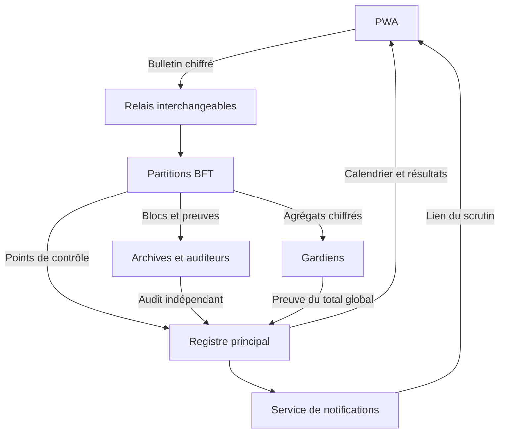

# Protocole civique
## Spécification technique et feuille de route vers la v1

**Statut** — RFC de conception 0.4 · Cible d’implémentation 1.0 · 3 novembre 2026  
**Périmètre** — Plateforme web, registre répliqué, scrutin binaire secret, gouvernance réversible et profil de juridiction.  
**Public** — Équipe protocole, produit, sécurité et opérateurs de nœuds. Le §12 sert de point de départ à Codex.

**Parcours de lecture** — §§1–5 pour l’architecture et le format du registre, §6 pour les règles de gouvernance, §7 pour le scrutin, §§8–11 pour l’exploitation et la portabilité, §§12–13 pour commencer le développement, **§14 pour le profil v1 à 10 millions et ses critères de qualification**, **§15 pour les mises à jour, l’agilité cryptographique et les urgences**.

## 1. Périmètre et décisions structurantes

Le protocole publie les règles, les propositions, les périodes de vote, les résultats agrégés et l’état des décisions. Il permet de proposer, amender ou abroger un texte et d’élire ou de révoquer des titulaires de fonctions. Toute personne peut installer un nœud complet, conserver les blocs, rejouer les transitions et vérifier les résultats. Les personnes qui s’inscrivent peuvent également soumettre des propositions, voter et activer les notifications.

| Décision | Profil v1 | Raison |
|---|---|---|
| Réseaux | Un réseau autonome par collectivité ou juridiction. Même protocole, profils et genèses distincts. | La population, le calendrier et les effets d’un vote varient selon le déploiement. Un réseau continue de fonctionner indépendamment des autres. |
| Consensus | CometBFT, branche 0.38, ABCI 2.0, moteur Go. Version et somme exactes figées au démarrage du développement. | Réutiliser finalité BFT, synchronisation et signatures de consensus. Le modèle métier définit les transitions. Aucun actif ni contrat Ethereum requis. |
| Capacité | Profil `scale_1` conçu pour 10 millions de comptes admissibles et autant de bulletins, à qualifier en v0.9. | Le profil donne la priorité au reçu durable. Les partitions enregistrent les bulletins rapidement et terminent le contrôle complet de façon asynchrone. Le registre principal finalise les points de contrôle et le résultat. |
| Réplication | Nœuds complets et archives accessibles sans inscription, validateurs de consensus admis par une procédure distincte. | La réplication publique améliore la disponibilité et l’audit. Elle reste ouverte même quand la création de comptes est gratuite et duplicable. |
| Identité | Compte cryptographique auto-inscrit. Registre des engagements électoraux figé par scrutin. | Garantie de **un bulletin compté par compte admissible et par scrutin**. L’unicité humaine relève d’un futur fournisseur d’éligibilité. |
| Secret | Admissibilité et unicité par Semaphore v4. Choix chiffrés et dépouillement agrégé par ElectionGuard 2.0. | Les nœuds peuvent vérifier les bulletins et le total à partir de données publiques, sans liste des électeurs ayant voté ni dépouillement nominatif. |
| Interface | PWA responsive, tableau de bord public, coffre de clés local, Web Push facultatif, boîte d’actualités intégrée. | Un même parcours sur ordinateur et téléphone. Le lien ouvre la question et le dossier avant le choix Oui ou Non. |
| Mise à jour | Correctifs compatibles, activation par version et voie de secours indépendante dès la v1 (§15). | Le réseau peut suspendre rapidement un usage vulnérable, puis remplacer une suite selon un plan approuvé et vérifiable. |
| Effets | Mode expérimental `pilot` en v1. Les textes et rôles ont un effet dans le registre. Les effets légaux externes nécessitent un raccordement à l’institution compétente. | Un résultat certifié au sens du protocole et une décision juridiquement exécutoire ont des preuves et des autorités différentes. |

Le cœur expose une machine d’état déterministe. Le transport BFT, les justificatifs d’éligibilité, les notifications et les futurs raccordements institutionnels constituent des interfaces séparées. Le profil `inline_dev` sert au développement local. La cible du pilote public v1 est `scale_1`, dont les règles de transport et de certification du §14 priment pour le vote de masse. Le changement des règles de consensus ou de leurs primitives suit une migration versionnée, avec une reprise indépendante prévue si la base de confiance est perdue (§15).

**Lecture normative.** « DOIT » désigne une condition d’interopérabilité. Les valeurs du profil de pilote sont proposées pour démarrer. La présente RFC fixe les formats et les règles du cœur. Les artefacts des suites externes et leurs vecteurs d’intégration doivent être figés et vérifiés aux jalons indiqués au §12.



## 2. Acteurs et modèle de confiance

| Acteur | Pouvoir et responsabilité | Preuve ou contrôle |
|---|---|---|
| Lecteur | Consulter la question, ses documents et les résultats. | Lecture publique via nœud, explorateur ou indexeur. |
| Titulaire de compte | Proposer, soutenir, voter anonymement, faire tourner ses clés, prendre part à la gouvernance. | Signature du compte pour les actes publics. Preuve anonyme pour un bulletin. |
| Hôte de nœud complet | Répliquer, exécuter et vérifier les blocs, servir des données et transmettre des transactions. | Contrôles du consensus et de l’état, reproductibles depuis une genèse authentifiée. |
| Hôte d’archive | Conserver les blocs historiques et les artefacts publics de tous les scrutins, fournir des données aux nouveaux nœuds. | Contrôle par les consommateurs via blocs signés et empreintes. |
| Validateur | Proposer ou signer des blocs selon CometBFT. | Sièges et clés consensus publics. Au profil à sept sièges de poids unitaire, cinq signatures sont nécessaires. |
| Gardien de scrutin | Participer à la génération de la clé du scrutin et au déchiffrement du seul agrégat dans le parcours normal. | Cérémonie et preuve vérifiables. Profil local 3/5. Profil de masse de référence 7/11. |
| Auditeur indépendant | Rejouer les données publiques du profil de masse et vérifier le résultat. | Attestation sur les racines rejouées et le résultat. La vérification publique reste ouverte. |
| Titulaire d’un rôle civique | Exercer les capacités approuvées par un scrutin et uniquement dans la portée du rôle. | Attribution et révocation inscrites au registre, vérification des capacités par le moteur. |
| Relais, indexeur et service Push | Transmettre des bulletins, servir des vues, livrer des notifications. | Services substituables. Leur accusé de réception et leur base de données ne font pas foi pour la finalité. |

Les clés de compte, de récupération, d’identité Semaphore, de consensus et de gardien sont séparées. En pilote multi-opérateurs, répartir validateurs, gardiens, archives et relais entre exploitants et infrastructures indépendants. Afficher leurs affiliations dans le manifeste du réseau. Deux validateurs compromis au plus sur sept donnent la borne de sécurité du profil BFT. La progression suppose aussi une connectivité suffisante et au moins cinq validateurs capables de communiquer. Les copies citoyennes peuvent conserver la preuve du dernier état lorsque le quorum cesse de progresser.

## 3. Réseau, profil et genèse

Un déploiement produit un manifeste signé et un fichier de genèse CometBFT. L’opérateur distribue leurs empreintes par plusieurs canaux indépendants et publie un catalogue des versions reconnues. Un client choisit explicitement le réseau. Il affiche son nom, son identifiant court et son mode sur les écrans de vote. Deux réseaux peuvent enregistrer des textes de même nom sans partager leur électorat ni leur autorité.

| Champ du manifeste | Contenu |
|---|---|
| `network_id`, `chain_id`, `genesis_sha256` | Identifiant réseau de 32 octets tiré aléatoirement. Identifiant CometBFT dérivé selon le §4. Empreinte du fichier de genèse en octets exacts. |
| `jurisdiction_id`, `display_name`, `locale`, `timezone` | Code local stable, libellé, langue par défaut, zone IANA. Les dates de consensus restent en UTC. |
| `mode`, `eligibility_provider`, `effect_profile` | Valeurs v1 `pilot`, `self_registered_v1`, `ledger_only_v1`. Les valeurs inconnues sont rejetées. |
| `voting_profile` | `inline_dev` ou `scale_1`. Pour `scale_1`, ajouter le manifeste de partitions, les clés d’audit et d’archive et les seuils associés (§14). |
| `initial_policy`, `initial_rosters` | Règles de dépôt et de vote, clés des validateurs, des gardiens et autres opérateurs désignés par le profil. |
| `consensus_lock`, `crypto_lock`, `app_version` | État initial des versions, empreintes des artefacts et versions de schéma. Le registre d’application porte ensuite les epochs, suites et plans approuvés (§15). |
| `upgrade_profile`, `recovery_root` | Règles de publication, quorums d’activation, clés de préparation et racine indépendante de reprise. La politique de rotation et les limites des pouvoirs sont fixées au §15. |
| `bootstrap` | Pairs, archives, relais, indexeurs et miroirs initiaux, avec plusieurs exploitants. Ces adresses restent des indications de découverte. |

Les champs normatifs correspondants figurent dans `app_state` de la genèse. Le manifeste ajoute les renseignements de découverte et `genesis_sha256`, qui reste hors de la genèse pour éviter une dépendance circulaire. Chaque client rejette une divergence entre la partie normative du manifeste et la genèse. La sécurité du premier démarrage dépend de l’obtention d’une genèse authentique. Une synchronisation rapide exige en plus un point de confiance récent obtenu de sources indépendantes et vérifié selon le client léger CometBFT. Le mode archive peut télécharger puis rejouer depuis la genèse. Le compromis d’anciennes clés de quorum reste une hypothèse à traiter lors du démarrage d’un nouveau client.

### 3.1 Politique initiale et limites du profil local

Le tableau et l’exemple de politique décrivent le mode `inline_dev`. Les règles de gouvernance s’appliquent aussi à `scale_1`. L’éligibilité, les plafonds de vote, les échéances de certification et les seuils opérateurs du profil de masse suivent le §14.

| Paramètre | Valeur initiale |
|---|---|
| Admissibilité | Comptes actifs enregistrés avant l’instantané d’ouverture. Aucun justificatif civil, email, numéro ou wallet externe. |
| Préparation du scrutin | Deux soutiens de comptes distincts de l’auteur dans les sept jours du dépôt. Préparation cryptographique au plus 48 h après qualification, puis préavis de 24 h. |
| Durée de vote et de dépouillement | 72 h de vote. 48 h pour publier un dépouillement valide. Valeurs de démonstration raccourcissables uniquement sur un réseau de développement distinct. |
| Seuil de décision ordinaire | Majorité stricte des bulletins valides, zéro quorum par défaut. Aucun résultat adopté si aucun bulletin. |
| Décision constitutionnelle | Au moins deux tiers des bulletins valides et participation d’au moins 20 % des comptes admissibles. Ce quorum protège une procédure en pilote. Il ne résout pas les comptes multiples. |
| Mise en application | Au moins 24 h après certification ordinaire, sept jours après certification constitutionnelle. Un projet peut proposer un instant plus tardif. |
| Limites | 65 536 comptes actifs au plus pour l’adaptateur Semaphore de profondeur 16. 131 072 comptes cumulés au plus, enregistrements retirés compris. Au plus 128 propositions non terminales, dont 16 scrutins en préparation, annoncés, ouverts ou en dépouillement. |
| Tailles | Texte d’une loi 128 Kio en UTF-8, transaction 256 Kio, bloc CometBFT 2 Mio au plus, avec des plafonds par type et vérification sur données pilotes. |

La charge normative de la politique est un objet complet dont les champs initiaux sont les suivants. Les plafonds techniques du tableau précédent sont ceux de la suite et restent séparés du vote paramétrique.

```json
{
  "collection_ms": "604800000",
  "queue_ms": "604800000",
  "setup_ms": "172800000",
  "notice_ms": "86400000",
  "voting_ms": "259200000",
  "tally_ms": "172800000",
  "endorsements_required": "2",
  "ordinary_quorum_bps": "0",
  "constitutional_quorum_bps": "2000",
  "ordinary_execution_delay_ms": "86400000",
  "constitutional_execution_delay_ms": "604800000"
}
```

Les durées et seuils sont paramétrables dans des bornes compilées. Chaque durée vaut entre une heure et 30 jours, avec une durée de vote maximale de 14 jours et un délai constitutionnel minimal de 24 h. Les soutiens requis vont de 1 à 20. Le quorum ordinaire est compris entre 0 et 5 000 points de base, le constitutionnel entre 2 000 et 5 000. Le réseau de test local peut accélérer l’horloge simulée. Les profils de pilote partagent les mêmes règles d’adoption en voix. Une mise à jour des paramètres ne change que les propositions déposées après son activation. Les données de scrutin déjà fixées restent consultables. Les changements de format, de garanties de confidentialité ou de séparation des autorités suivent la gouvernance des versions du §15. Les résultats affichent le nombre de comptes admissibles, le nombre de bulletins et leurs proportions. Le mot « population » est réservé à un déploiement disposant d’une base d’éligibilité qui le justifie.

## 4. Registre, format et exécution

### 4.1 Encodage et signatures

- Les transactions d’application et les valeurs d’état utilisent **JSON canonique RFC 8785**, UTF-8 strict. Les parseurs DOIVENT rejeter clés dupliquées, champs inconnus, types inattendus et documents dont les octets diffèrent après canonicalisation. Les champs texte créés par le protocole doivent être NFC avec fins de ligne LF. Les données cryptographiques externes restent des octets selon leur format propre.
- Les entiers et horodatages d’application sont des chaînes décimales canoniques `0|[1-9][0-9]*`, bornées selon le champ. Les temps sont des millisecondes Unix UTC en `uint64`. Les empreintes et clés publiques sont en hexadécimal minuscule, sans préfixe, de longueur imposée. Les blobs utilisent Base64url RFC 4648 sans remplissage, avec réencodage strict.
- `chain_id = "civ1-" + lowercase(base32(network_id[0:20], no_padding))`. Pour les domaines d’application, `D(tag, value) = SHA256(UTF8("CIVIC/1/" + tag + LF) || JCS(value))`. Dans une structure JSON, on encode sa sortie par 64 caractères hexadécimaux. Les tags appartiennent au schéma, avec casse exacte.
- Une transaction ordinaire contient `body` et `auth`. `body` contient `v:"1"`, `network_id`, `type`, `actor_id`, `nonce` et `payload`. `tx_id = D("tx", body)`. `auth` contient `scheme:"ed25519"` et `signature`, signature Ed25519 RFC 8032 sur les 32 octets de `tx_id`. Les clés et signatures mal encodées sont rejetées.
- Une transaction autorisée par preuve, `poll.configure`, `vote.cast` ou `poll.tally`, utilise le même `body` avec `actor_id:null` et `nonce:null`, et `auth:{"scheme":"proof"}`. Les vérifications propres au type conditionnent l’autorisation. Le hash du corps couvre le bulletin et ses preuves.
- Les comptes utilisent un nonce global. `account.register` utilise `0` et initialise le prochain nonce à `1`. Pour les autres transactions signées, le nonce DOIT correspondre au prochain nonce du compte dans l’ordre d’exécution du bloc. Un échec ne consomme aucun nonce. Le résultat de dépôt distingue `seen` d’une inclusion finalisée. Une retransmission identique renvoie le statut du même `tx_id` si le nœud le connaît.

### 4.2 Exécution et preuve d’état

`PrepareProposal` sélectionne les transactions valides dans leur ordre proposé en simulant le bloc. `ProcessProposal` rejoue ce même bloc et le rejette si une transition est invalide. `FinalizeBlock` prépare le résultat décidé. `Commit` le rend durable de façon atomique. En cas de reprise, la liaison ABCI rapproche la dernière hauteur durable et le journal de blocs, puis rejoue si nécessaire. `CheckTx` filtre tôt, à partir d’un état local possiblement en retard. Il ne garantit ni inclusion ni ordre. Les preuves sont vérifiées avec les mêmes artefacts locaux. En `inline_dev`, limiter chaque bloc à 32 bulletins et à quatre transactions de cérémonie ou de dépouillement au total. Le réseau rejette les blocs qui dépassent ces budgets déterministes, même sous le plafond d’octets. Les appels de validation filtrent d’abord schéma, domaine, tailles, phase et doublons avant la cryptographie. Dans `scale_1`, le registre principal rejette les `vote.cast`. Chaque partition finalise les dépôts avant la clôture et vérifie les preuves complètes séparément. Le registre principal vérifie les points de contrôle portés par ses transactions. Le calcul de consensus n’utilise ni horloge locale, ni appel réseau externe, ni résultat de l’indexeur.

Pour un bloc `h`, `T_h = max(T_(h-1), floor(header.time en millisecondes))`, où l’horodatage est celui validé par CometBFT. Un bloc exécute d’abord les transitions échéantes, puis les transactions dans l’ordre du bloc. Les blocs vides restent activés. Un calendrier fixé en UTC reste soumis à l’avancement et aux hypothèses de temps du consensus. Pendant une panne de quorum, afficher « réseau arrêté » et le dernier bloc vérifié. Un dossier arrivé à échéance peut être redéposé en référençant le dossier clos. La réouverture du même scrutin et la prolongation rétroactive ne sont pas autorisées en v1. Le client ne doit jamais fabriquer une prolongation à partir de l’heure du téléphone.

Les transitions automatiques se traitent dans l’ordre **clôtures**, **expirations**, **mises en application**, **ouvertures**, **admission de la file**, puis les transactions. À l’intérieur d’une phase, trier par `(deadline_ms, object_id)`. Une proposition candidate à une étape passe au plus une fois par phase. Un instantané d’ouverture utilise les comptes actifs à la fin du bloc précédent. Un dépôt en cours de bloc n’entre donc pas dans un scrutin ouvert par ce même bloc. Les échéances, y compris une clôture sans vote, ont des événements d’état.

L’état est stocké dans un arbre de Merkle clairsemé de profondeur 256. Pour une table et une clé métier, `K = D("state/key", [table, key])`. Pour une valeur JCS `V`, la feuille vaut `SHA256(0x00 || K || SHA256(V))`. Une feuille vide vaut `SHA256(0x02)`. Un parent vaut `SHA256(0x01 || left || right)`, avec descente depuis le bit de poids fort de `K`. Les sous-arbres vides se calculent récursivement. Les noms et clés primaires figurent ci-dessous. Les index d’API dérivés et les métriques locales sont hors de cet arbre. La racine retournée comme `AppHash` après `h` est authentifiée dans l’en-tête du bloc suivant, selon CometBFT. La preuve d’inclusion d’une transaction dans le bloc `h` et la preuve d’une valeur d’état après `h` sont donc des réponses distinctes.

| Table | Clé métier | Contenu minimal |
|---|---|---|
| `network` | `"config"` | Profil, politique active et versions de politique, epoch des sièges, paramètres verrouillés. |
| `upgrades` | Identifiant de plan ou d’instance | Plan canonique, approbation, preuves de préparation, barrières et état d’activation. |
| `security` | Réseau et epoch de reprise | Racine de secours, dernier compteur et portées en suspension. |
| `accounts` | `account_id` | Clé active, clé de récupération, engagement Semaphore, nonce suivant, statut, bloc d’inscription. |
| `proposals` | `proposal_id` | Auteur, objet, révision attendue, charge, soutiens, état, délais, résultat et lien d’exécution. |
| `polls` | `poll_id` | Manifeste et contexte crypto, racine des admissibles, échéances, agrégat, compte, statut et preuve du résultat. |
| `spent` | `[poll_id, nullifier]` | `tx_id` du premier bulletin finalisé et position de bloc. |
| `ballots` | `[poll_id, ballot_id]` | Empreinte du bulletin, code de confirmation et référence au bloc qui contient les octets. |
| `ciphertexts` | `[poll_id, ciphertext_digest]` | Marqueur de chiffré accepté, avec `ciphertext_digest = D('vote/ciphertext', canonical_selection_ciphertext)`. |
| `objects` | `[kind, object_id]` | Pointeur vers la dernière révision, état courant et type. |
| `revisions` | `[kind, object_id, revision]` | Révision immuable, décision source, texte ou capacités, état et instant effectif. |
| `grants` | `[role_id, grant_id]` | Compte titulaire, période, décision d’attribution et éventuelle décision de révocation. |

Les écritures atomiques couvrent l’état, les marqueurs de reprise, le bloc appliqué et les événements dérivés nécessaires à la relecture locale. Une reprise après arrêt DOIT aboutir au même `AppHash`. Les événements exposés ont un identifiant déterministe `D("event",[network_id,height,index])`, où `index` commence à zéro dans le bloc, transitions automatiques d’abord. La création des événements est une sortie déterministe de la transition. Le client qui a besoin de les authentifier rejoue le bloc ou vérifie les valeurs d’état correspondantes. L’indexeur restaure sa projection en rejouant les événements depuis un bloc et dédoublonne par identifiant.

### 4.3 Séparation des réseaux et transactions reconnues

Le moteur rejette un `network_id` étranger et un `v` incompatible. Les charges et règles d’autorisation sont définies par les sections suivantes.

| Type | Autorité et charge |
|---|---|
| `account.register` | Nouvelle clé active. `{signing_pk, recovery_pk, commitment}`. |
| `account.rotate` | Clé de récupération enregistrée. `{signing_pk, recovery_pk, commitment}`. |
| `account.retire` | Clé de récupération. `{}`. |
| `proposal.submit` | Compte actif. `{action, target_id, expected_revision, rationale, requested_effect_ms, changes}`. Les champs inapplicables sont `null`, les autres sont obligatoires. |
| `proposal.endorse` | Compte actif. `{proposal_id}`. Un soutien distinct par compte, auteur exclu. |
| `poll.configure` | Toute personne qui fournit les attestations valides de tous les gardiens épinglés au dossier. `{poll_id, ceremony_bundle, guardian_acks}`. |
| `vote.cast` | Preuve anonyme et preuve de validité du bulletin. Charge définie au §7. |
| `poll.tally` | Preuve cryptographique de dépouillement. `{poll_id, yes, no, aggregate_digest, decryption_record}`. |
| `lane.checkpoint`, `audit.attest`, `audit.challenge` | Types du registre principal en `scale_1` uniquement. Respectivement certificat de partition avec disponibilité, attestation signée sur le rejeu et contestation vérifiable (§14). |
| `upgrade.publish_plan`, `upgrade.prepare`, `upgrade.ready`, `upgrade.arm`, `security.hold`, `security.arm_reserve`, `recovery.publish` | Contrôle de version et réponse aux incidents. Autorisations et preuves de portée propres au §15. Ces messages ne réutilisent pas la clé d’un compte citoyen pour autoriser une opération d’urgence. |
| `role.publish` | Compte titulaire d’une capacité en cours. `{role_id, capability, target_id, content}`. L’événement public est signé et attribué à son auteur. |

Les lois et autres textes mis aux voix sont stockés dans les blocs. Le format de départ est du texte UTF-8 traité comme texte ou Markdown avec assainissement strict, sans HTML actif. Les pièces volumineuses facultatives peuvent être référencées par empreinte, taille et type. Une pièce indispensable à la compréhension de la question doit être intégrée à la proposition. Les pairs ne demandent aucun service de documents au moment de valider un bloc.

## 5. Comptes, inscription et récupération

1. L’utilisateur sélectionne le réseau et choisit **Créer un compte**. Le client génère localement une clé Ed25519 d’usage, une clé Ed25519 de récupération indépendante et une identité Semaphore v4. Aucune identité civile ni clé privée n’est envoyée. La PWA confirme l’inscription après finalité.
2. `account_id = D("account", [network_id, initial_signing_pk])`. L’adresse reste stable après rotation. L’inscription rejette un identifiant déjà pris, une clé active ou de récupération déjà liée à un autre compte, et un engagement Semaphore nul, invalide ou déjà utilisé. Les engagements retirés ne peuvent être réattribués. Ce contrôle évite de compter deux fois une même identité cryptographique, avec inscription libre de plusieurs identités distinctes.
3. Le client conserve les clés d’usage et de vote dans un coffre local AES-256-GCM. La clé locale non exportable est créée par Web Crypto et conservée dans IndexedDB sous la même origine. Cela permet de revenir voter sans ressaisir un secret et laisse le coffre exposé à un script malveillant exécuté sous cette origine. La clé de récupération reste dans l’export de secours chiffré. Chaque chiffrement utilise un nonce aléatoire frais de 96 bits. Pour l’export, dériver la clé d’un secret aléatoire de 256 bits avec HKDF-SHA-256, sel aléatoire de 32 octets et `info=UTF8('CIVIC/1/backup')`. L’export JCS contient `{header,salt,iv,ciphertext}`, avec `header={v,network_id,account_id}` utilisé comme AAD JCS. L’import vérifie le réseau et compare les clés dérivées des secrets aux données du compte. Le code de sauvegarde est affiché à l’utilisateur puis effacé de l’écran. Une sauvegarde est importable sur téléphone ou ordinateur. Un déverrouillage par passkey peut être ajouté sur les appareils compatibles.
4. La récupération peut tourner la clé d’usage, la clé de récupération et l’engagement par `account.rotate`. Le compte reste actif. `account.retire` désactive le compte pour les actes ultérieurs et les prochains instantanés. Les droits d’un scrutin ouvert sont ceux de son instantané. Un utilisateur qui tourne sa clé d’identité de vote doit conserver l’ancienne clé locale jusqu’à la clôture s’il souhaite encore exercer ce droit. Un attaquant qui possède l’ancienne identité peut, pendant cette fenêtre, voter à sa place. En cas de perte de toutes les clés de secours, le protocole ne sait pas attribuer l’ancien compte à un nouvel appareil.

Les clés publiques et engagements d’inscription sont publics, tout comme les actes publics signés. Le compte peut utiliser un pseudonyme d’interface conservé localement. Les preuves de bulletin ne contiennent ni `account_id` ni signature de la clé du compte. L’abonnement aux notifications reste indépendant des clés de vote.

## 6. Gouvernance, lois, rôles et réversibilité

### 6.1 Actions votables

Les actions sont déclaratives, typées et exhaustives. Une proposition définit une seule action, sans script arbitraire. Le `proposal_id` est le `tx_id` de `proposal.submit`. Pour une création, le nouvel `object_id = D("object",[kind,proposal_id])`. Toute révision débute à `"1"` et augmente de un. L’ancienne version reste lisible. La charge et la révision de référence restent fixes après dépôt. Une correction passe par une nouvelle proposition.

| Action | `target_id`, `expected_revision` et `changes` | Effet si applicable |
|---|---|---|
| `law.create` | Deux premiers champs `null`. `{title,text,language}`. | Crée une loi pilote active. |
| `law.amend` | ID de loi et révision active attendue. `{title,text,language}`. | Remplace le contenu par une nouvelle révision complète. Le client peut calculer un diff. |
| `law.repeal` | ID de loi et révision active attendue. `{}`. | Abroge à compter de la date d’effet. La dernière version et son historique restent disponibles. |
| `law.restore` | ID de loi et révision courante attendue. `{source_revision}`. | Recopie une révision précédemment active dans une nouvelle révision active. Le public voit la source et la date d’effet du rétablissement. |
| `role.create` | Deux premiers champs `null`. `{label,description,capabilities,scope_id}`. | Crée une définition de rôle sans titulaire. `scope_id` vaut l’ID d’une loi pilote active ou `null` pour l’ensemble du réseau. |
| `role.amend` | ID de rôle et révision active attendue. Même charge que `role.create`. | Remplace la définition. Les attributions existantes restent, avec les capacités de la nouvelle définition. La fiche du scrutin liste les effets sur les titulaires concernés. |
| `role.retire` | ID de rôle et révision active attendue. `{}`. | Retire le rôle et termine ses attributions à la date d’effet. Les traces d’attribution restent visibles. |
| `role.restore` | ID de rôle et révision courante attendue. `{source_revision}`. | Rétablit la définition d’une révision active passée. Si le rôle avait été retiré, les anciens titulaires restent révoqués et chaque réattribution est votée. |
| `role.grant` | ID de rôle et révision active attendue. `{account_id,until_ms}`. | Attribue le rôle à un compte actif pour une durée bornée. `grant_id = proposal_id`. Une seule attribution active pour la paire rôle-compte. |
| `role.revoke` | ID de rôle et révision active attendue. `{grant_id}`. | Termine l’attribution désignée à la date d’effet. Une nouvelle attribution est possible par un autre scrutin. |
| `policy.update` | `target_id:null` et version courante attendue. `{policy}` contenant le profil complet après changement. | Active une politique validée pour les dépôts suivants. Action constitutionnelle. |
| `network.rotate_validator` | `target_id:null` et epoch courant des sièges. `{old_consensus_pk,new_consensus_pk,new_operator,proof_of_possession}`. | Remplace un siège de poids unitaire. Action constitutionnelle. Le candidat signe `D("validator/ready",[network_id,epoch,old_consensus_pk,new_consensus_pk,new_operator])` avec sa clé consensus. |
| `protocol.approve_upgrade` | `target_id:null` et epoch courant attendu. `{plan_id,approval_class}`, où la classe vaut `planned` ou `reserve`. | Autorise le plan exact ou le prépare comme réserve. Action constitutionnelle. L’armement et la préparation restent séparés (§15). |
| `network.rotate_guardian` | `target_id:null` et epoch courant des gardiens. `{old_account_id,new_account_id,new_operator,new_account_consent}`. | Remplace un gardien pour les dossiers déposés après activation. Le candidat signe `D("guardian/ready",[network_id,epoch,old_account_id,new_account_id,new_operator])`. Action constitutionnelle. |

`rationale` est public et obligatoire. Il contient le motif, les éventuels effets transitoires et une description intelligible de la décision proposée. `language` est une étiquette BCP 47. Une annexe de schéma implémentée à la v0.1 encode les bornes de chaque chaîne, liste et objet. Les valeurs initiales sont 160 caractères pour titre et libellé, 16 Kio pour le motif, 8 Kio pour description et publication de rôle, cinq capacités au plus, et une attribution de 365 jours au plus à compter de l’effet. Les longueurs indiquées en caractères se mesurent en valeurs scalaires Unicode après NFC. Les limites en Kio se mesurent en octets UTF-8. `until_ms` doit être strictement après la date d’effet.

La v1 reconnaît trois capacités de rôle. `annotate_proposal` joint un avis public à une proposition dont l’objet entre dans la portée. `publish_notice` publie un avis public sur une loi de la portée. `report_implementation` publie un état d’exécution sur une loi de la portée. Ces capacités ajoutent des événements signés, sans mutation directe des lois ou des scrutins. Un rôle n’accorde jamais de voix supplémentaire ni d’accès aux secrets de vote. Il ne peut modifier les listes d’admissibilité, les résultats, les clés de consensus, les politiques ou les attributions.

Un remplacement de validateur requiert un opérateur candidat prêt et vérifié par les opérateurs avant le vote. Le moteur vérifie la preuve de possession, la clé nouvelle, l’ancien siège et l’epoch attendu. La demande d’effet est envoyée comme mise à jour ABCI au bloc d’application `H`. Pour la branche 0.38, la nouvelle composition participe au consensus de `H+2`, sous réserve du test de conformité du §12. L’explorateur publie séparément la décision appliquée et la hauteur d’entrée effective du siège. Une rotation ne remplace qu’un siège. L’opérateur sortant maintient son service jusqu’à la hauteur de transition. Les rotations de gardiens préservent les obligations des anciennes équipes pour leurs scrutins déjà qualifiés. La clé Ed25519 civique d’un gardien signe ses attestations de cérémonie. La clé de déchiffrement est distincte et recréée pour chaque scrutin.

### 6.2 États d’une proposition et conditions de transition

Ce tableau donne le déroulement de référence du profil local. Dans `scale_1`, la clôture des dépôts fige les journaux. La vérification continue ensuite. Le dépouillement attend les scellés de traitement de toutes les partitions, puis un résultat valide mène à `provisional` et à la certification après audit. Un dossier incomplet, une preuve d’erreur valide ou un état dégradé au sens du §14 n’entraîne pas de mise en application. Un scrutin placé en `interrupted` par le §15 conserve ses preuves et reste exclu de la certification automatique.

| État | Entrée et sortie |
|---|---|
| `collecting` | Dépôt finalisé. À la fin du bloc où le seuil de soutiens fixé par la politique est atteint, passe à `qualified` et rejoint la file. À expiration du délai de collecte avant qualification, passe à `expired`. |
| `qualified` | En attente d’un créneau. La file est ordonnée par hauteur de qualification puis `proposal_id`. Lorsqu’un créneau se libère, passe à `preparing`. Si aucun créneau après `queue_ms` à compter de la qualification, passe à `expired`. |
| `preparing` | Fixe les gardiens, `poll_id = D("poll",[network_id,proposal_id])` et le délai de cérémonie. Si le paquet est validé à temps, passe à `scheduled`. Sinon `failed_setup`. |
| `scheduled` | Fixe `opens_at`, `closes_at` et `tally_due_at` pour l’affichage. Lorsque le temps de bloc atteint `opens_at` et précède `closes_at`, ouvre et fige l’électorat. Si le premier bloc d’ouverture possible est déjà à la clôture, passe à `failed_window`. |
| `open` | Accepte les bulletins sur l’intervalle `[opens_at, closes_at)`. Au premier bloc à la clôture ou au-delà, fige l’agrégat et passe à `tallying`. |
| `tallying` | Si zéro bulletin, le moteur enregistre un résultat vide et rejette le projet. Sinon, une preuve valide avant `tally_due_at` produit `adopted` ou `rejected`. À échéance, `failed_tally`. |
| `adopted` | Attend la date d’effet. Si les préconditions sont toujours remplies, applique la décision et passe à `applied`. Sinon, passe à `conflict`, avec la révision ou cause de conflit enregistrée. |
| États terminaux | `applied`, `rejected`, `conflict`, `expired`, `failed_setup`, `failed_window`, `failed_tally`. Une nouvelle proposition peut référencer le dossier clos dans son motif. |

Le dépassement du plafond des propositions actives fait échouer un nouveau dépôt avec `ERR_CAPACITY`. Le profil de politique, le roster des gardiens et les clés d’attestation utilisées par un dossier proviennent de l’état au dépôt. Les clés consensus et la disponibilité des sièges continuent de suivre l’état du réseau. La durée de préparation `setup_ms` commence à l’entrée en `preparing`. La publication du paquet cryptographique fixe `opens_at = T_h + notice_ms`, `closes_at = opens_at + voting_ms`, `tally_due_at = closes_at + tally_ms`. Une transaction arrivée dans un bloc au temps exact d’une échéance ne prolonge pas l’étape qui se clôture.

Soient `Y` et `N` les totaux certifiés Oui et Non, `C = Y+N` et `E` le nombre de comptes admissibles à l’ouverture. Pour un quorum configurable `q` en points de base, la condition de participation est `10000C >= qE`. La condition ordinaire est `C>0 && 2Y>C` et le quorum ordinaire du dossier doit être atteint. La condition constitutionnelle est `C>0 && 3Y>=2C && 10000C>=2000E` pour le profil initial. L’égalité Oui/Non rejette. Les vérifications utilisent des entiers avec multiplications bornées ou élargies. L’absence de bulletin et l’absence de dépouillement valide sont affichées comme des cas distincts. Les pourcentages sont calculés pour l’interface après certification.

Pour une décision adoptée à `T_cert`, `effective_at = max(requested_effect_ms si fourni, T_cert + execution_delay_ms)`. Le moteur applique au premier bloc dont `T_h >= effective_at`. Il compare la révision attendue et revérifie les contraintes de portée, d’existence, d’expiration et de titularité. Si deux décisions concurrentes modifient la même révision, l’ordre déterministe du §4 tranche et la suivante devient `conflict`. Les attributions modifient leurs propres enregistrements, sans créer une nouvelle révision de définition de rôle. Une restauration et une abrogation produisent des effets prospectifs. Une transaction exécutée, un avis publié ou un effet externe déjà intervenu conserve son historique.

## 7. Scrutin secret et vérifiable

Les formats de cette section décrivent le scrutin `inline_dev`. Le profil `scale_1` garde les deux suites et le vote binaire, avec un instantané incrémental, des bulletins transportés par partitions, une preuve d’indépendance du chiffré et une certification après audit (§14).

### 7.1 Suites et séparation des preuves

**Semaphore v4** atteste qu’un engagement d’identité figure dans le groupe figé et produit un `nullifier` stable pour cette identité et ce scrutin. Il masque l’engagement utilisé. **ElectionGuard 2.0** chiffre le choix sous la forme d’un bit, avec une preuve que le chiffré représente 0 ou 1. Les rôles sont complémentaires. Le résultat de dépouillement est vérifié sur l’agrégat des bulletins admis.

Le profil de référence utilise `@semaphore-protocol/{identity,group,proof}` **4.14.5** et le circuit de profondeur 16. Au jalon v0.3, enregistrer le tag exact, les sommes SHA-256 du WASM, du zkey et de la clé de vérification Groth16, ainsi que leur origine et les vecteurs de vérification. Les validateurs et navigateurs vérifient ces empreintes avant chargement. Le circuit, la convention de hachage interne, l’ordre des entrées publiques et la représentation des points proviennent de l’adaptateur de la version verrouillée. Aucun artefact fourni par le votant ne peut substituer le circuit. Le vérificateur Go ou WASM local devra être testé contre le SDK TypeScript de référence.

Pour ElectionGuard, la référence est **Design Specification 2.0** et **Serialization Specification 0.0.1**, dont le format correspond à la version 2.0. Le sous-profil v1 crée un concours et une seule sélection chiffrée obligatoire `yes_bit`, avec limite de sélection égale à un. Le bit 1 encode Oui et le bit 0 encode Non. L’absence de bulletin représente l’abstention. Exiger la présence d’un unique chiffré de sélection et les preuves ElectionGuard imposées pour le profil, y compris sa preuve d’intervalle 0–1. Le moteur ne déduit pas un Non d’un champ manquant. Les votes en clair et les sélections supplémentaires sont rejetés.

### 7.2 Préparer et ouvrir

1. Les cinq gardiens du dossier produisent un contexte ElectionGuard frais, à seuil de déchiffrement trois sur cinq. Les échanges de secrets de la cérémonie suivent la suite. Seuls le manifeste, le contexte public et les preuves et enregistrements publics nécessaires au contrôle sont soumis au registre. Chaque gardien atteste le même paquet public, après vérification des pièces requises et des parts reçues.
2. `ceremony_bundle` est un blob Base64url d’un objet JCS. Le paquet contient `{suite, files}`. Chaque élément de `files` contient `{path,bytes}` avec chemin relatif ASCII de la spécification de sérialisation et octets Base64url. La liste est triée par chemin, sans doublons ni segments `.` ou `..`. Le champ `suite` vaut `eg-2.0-civic-1`. Les chemins du tableau qui suit appartiennent à l’enveloppe de ce protocole. Le contenu des entrées ElectionGuard est interprété par l’adaptateur avec la spécification de sérialisation verrouillée. L’annexe d’interopérabilité v0.4 publie le mapping champ par champ et des paquets de test. Les attestations `guardian_acks` contiennent les cinq `{account_id,signature}` triés par `account_id`. Chacune signe `D("poll/ceremony",[network_id,poll_id,hex(SHA256(ceremony_bundle décodé))])` avec la clé d’attestation épinglée au dossier. Le moteur vérifie le réseau, le `poll_id`, la proposition immuable, le manifeste et la clé commune avant d’accepter le paquet. Le manifeste utilise `poll_id` comme identifiant d’élection, un concours `civic_question` et une seule sélection `yes_bit`. L’interface présente le type d’action, le titre et le texte exacts du corps de proposition. Le fichier de liaison engage leur référence par `question_digest = D('poll/question',[network_id,poll_id,proposal_id])`.
3. À l’ouverture, le moteur trie les comptes admissibles par `account_id` en ordre lexicographique des octets, puis insère leurs engagements dans le groupe LeanIMT de Semaphore v4 dans cet ordre. Il fixe `group_root`, `eligible_count`, `snapshot_height` et le profil de vérification. Les clients obtiennent la liste des engagements ou une preuve de chemin depuis un nœud et vérifient la racine authentifiée. Le vote utilise exclusivement la racine de l’instantané d’ouverture. Si le groupe est vide, l’état fixe `group_root:null` et refuse tous les bulletins. Aucune racine historique alternative n’est admise.

| Paquet | Entrées autorisées |
|---|---|
| Cérémonie | `link.json` avec `{network_id,poll_id,proposal_id,question_digest}`, `manifest.json`, `context.json` et `guardians/01.json` à `guardians/05.json`. Les indices sont assignés par ordre de `account_id`. Les entrées gardiens contiennent leurs données et preuves publiques nécessaires à la vérification de la clé commune. |
| Bulletin | `ballot.json`, contenant uniquement la représentation publique ElectionGuard d’un bulletin chiffré. Rejeter les champs d’ouverture et tout identifiant ou statut en clair qui encode ou révèle le choix. Les métadonnées chiffrées éventuelles ont un format et une taille indépendants du choix. |
| Dépouillement | `tally.json`, enregistrement public ElectionGuard du déchiffrement et de sa preuve pour la sélection agrégée. `poll.tally.aggregate_digest` lie ce paquet à l’état de clôture. |

### 7.3 Construire, soumettre et vérifier un bulletin

1. Le client vérifie le contexte du scrutin et présente le texte ou la question lié au manifeste. Il chiffre localement le bit correspondant à Oui ou Non et construit les preuves de bonne formation selon ElectionGuard. Il choisit un identifiant de bulletin frais et aléatoire. Aucun identifiant d’appareil, de compte ou de session n’entre dans le bulletin. Si le format exige une métadonnée de dispositif, le sous-profil emploie une valeur commune au scrutin, compatible avec la vérification. Les paramètres cryptographiques du bulletin sont contrôlés par l’adaptateur.
2. Le blob `encrypted_ballot` suit le format de paquet du §7.2. Soit `B` son contenu décodé. Définir `scope = uintBE(D("vote/scope",[network_id,poll_id])[0:31])`. Définir `message = uintBE(D("vote/message",[network_id,poll_id,hex(SHA256(B))])[0:31])`. Ces entiers de 248 bits sont les valeurs d’entrée du SDK avant ses propres traitements. Le lien `message` empêche de réutiliser une preuve pour un autre chiffré. Le `scope` est distinct d’un scrutin et d’un réseau à l’autre.
3. `vote.cast.payload = {poll_id, encrypted_ballot, membership}`. `membership = {merkleTreeDepth,merkleTreeRoot,nullifier,message,scope,points}`, selon le type `SemaphoreProof` verrouillé. La profondeur, les valeurs du corps et les coordonnées ou éléments du tableau de preuve sont encodés en chaînes décimales selon le §4. L’adaptateur convertit `merkleTreeDepth` en entier du SDK après vérification de l’égalité à 16. Les champs publics sont comparés aux valeurs attendues et aux bornes de leur champ ou groupe avant la vérification. Le portefeuille transmet la transaction au relais de son choix sans cookie ou session de compte.
4. Le nœud vérifie le réseau, la période, la racine, `message`, `scope`, la preuve d’appartenance et la preuve ElectionGuard. Il refuse un `nullifier` déjà consommé, un identifiant de bulletin déjà utilisé et un doublon de chiffré de sélection canonique. L’empreinte de chiffré est indexée sous la clé `[poll_id, ciphertext_digest]` dans la table `ciphertexts`. L’inclusion et l’écriture du `nullifier` sont atomiques. Si deux bulletins différents d’un même compte arrivent, le premier **finalisé** l’emporte. Une copie exacte envoyée par un tiers ne change ni le choix chiffré ni l’empreinte. La v1 garde un seul bulletin et ne permet pas le revote.
5. Le client affiche un code de confirmation lié au bulletin chiffré et son statut. Il peut vérifier l’inclusion depuis un nœud indépendant ou via les preuves du §8. Ce code et les données publiques ne publient pas le choix. Un client qui conserve ses aléas ou divulgue son écran peut cependant fournir des informations à un tiers. Le protocole ne revendique pas de résistance à la coercition ni de propriété d’absence de reçu au sens cryptographique.

### 7.4 Clôturer et dépouiller

Le moteur agrège homomorphiquement les chiffrés de `yes_bit` en même temps qu’il accepte les bulletins. À la clôture, il fige `closed_height`, `count`, l’agrégat et `aggregate_digest = D("poll/aggregate",[network_id,poll_id,closed_height,count,aggregate])`, où `aggregate` contient la représentation canonique du chiffré agrégé de `yes_bit`. Les gardiens vérifient l’agrégat depuis des nœuds indépendants. Ils produisent les preuves ElectionGuard de déchiffrement de cet agrégat. Le système ne sollicite jamais de parts de déchiffrement de bulletins individuels dans ce parcours. En l’absence de quorum de gardiens, le scrutin expire à l’échéance.

Toute personne peut soumettre `poll.tally` à partir d’un enregistrement de déchiffrement public. Le moteur n’accepte qu’un dépouillement dont la preuve vérifie l’agrégat figé, le contexte du scrutin et le total `Y` annoncé, avec `0 <= Y <= count` et `N = count - Y`. Le champ `aggregate_digest` de la transaction doit égaler celui de l’état de clôture. Le moteur vérifie également la preuve sur le chiffré de cet état. Un observateur peut reconstruire le groupe, vérifier chaque bulletin et le total avec ses propres outils. Il peut exporter manifeste, contexte, bulletins admis, preuves, agrégat, résultat et positions de blocs.

### 7.5 Ce que permet l’audit

| Question | Réponse vérifiable ou hypothèse |
|---|---|
| Un compte a-t-il voté deux fois ? | Deux preuves de la même identité et du même scrutin donnent le même `nullifier`. Les nœuds vérifient qu’au plus un bulletin correspondant est compté. |
| Peut-on publier qui a voté ou qui a voté quoi ? | L’interface publique ne fournit ni liste de participation individuelle ni choix nominatif. Les engagements d’éligibilité sont publics. Leur relation aux bulletins repose sur la sécurité du circuit et peut être affaiblie par des métadonnées externes. |
| Le choix affiché a-t-il été correctement chiffré ? | La preuve valide le format et l’appartenance à Oui/Non. Une PWA compromise pourrait chiffrer un autre choix. Les preuves d’inclusion et de dépouillement ne testent pas l’intention affichée. Les bulletins de défi vérifiables et une implémentation cliente indépendante sont des jalons ultérieurs. |
| Le secret résiste-t-il à une collusion ? | Trois gardiens de la même cérémonie pourraient déchiffrer des bulletins archivés. Renouveler les secrets par scrutin, séparer les opérateurs et effacer les parts à l’issue de la période d’audit réduisent l’exposition. L’effacement reste une mesure opérationnelle à vérifier. La publication d’agrégats de petits groupes permet aussi des inférences. |
| Le réseau sait-il qu’il s’agit d’une seule personne ? | En v1, l’unité est le compte. Les comptes multiples et leur coordination peuvent changer le résultat et les nominations. Un fournisseur d’éligibilité futur devra attester l’unicité dans une population légitime et offrir correction et recours. |

Les relais n’ont pas besoin de recevoir l’identité et évitent la journalisation des adresses IP, cookies et identifiants de suivi. Les métadonnées de temps, les observateurs du réseau et la corrélation entre inscription et soumission demeurent des risques. Une couche de relais multiples et, ultérieurement, de soumission par lots peut réduire la corrélation. Le modèle à distance suppose un appareil et un contexte suffisamment sûrs. Cette hypothèse devient particulièrement importante dans les environnements où un choix politique expose à des représailles.

## 8. Nœuds publics, synchronisation et API

### 8.1 Installer et vérifier

La distribution de référence prévoit une image OCI publiée avec une empreinte de contenu et un binaire Linux pour amd64 et arm64. Un opérateur choisit un manifeste, vérifie la genèse et peut lancer un nœud public sans compte et sans clé de consensus. Les commandes ci-dessous sont des interfaces à implémenter, à valider en v0.6.

```sh
civnode init --manifest ./network.json --genesis ./genesis.json
civnode start --mode archive
civnode verify --from genesis
# Profil scale_1. Répliquer une partition en plus du registre principal.
civnode start --mode archive --lanes 0
civnode status
civnode election export --poll-id ID --output ./election-record
civnode election verify --input ./election-record
```

- **Archive** conserve blocs, commits, transactions et artefacts publics depuis la genèse. Elle offre un téléchargement reprenable et le rejeu complet. Le démarrage rapide peut accepter un instantané de l’état. Ce mode ne prétend conserver l’historique antérieur que si les blocs correspondants ont aussi été téléchargés et vérifiés.
- **Nœud complet avec élagage** vérifie les nouveaux blocs et conserve l’état courant plus une fenêtre récente. Le statut indique les premières hauteurs de bloc et d’état disponibles. Un nouvel opérateur peut choisir le mode archive pour préserver tout l’historique. La découverte initiale repose sur plusieurs pairs du manifeste et l’échange de pairs du moteur. Une adresse annoncée ne donne aucun droit de validation. Limiter les connexions et conserver des pairs sortants dans plusieurs domaines réseau pour limiter l’isolement du nœud.
- **Validateur** utilise en plus une clé de consensus dédiée, un dispositif de signature sécurisé et un état anti-double-signature. L’endpoint de signature ou d’administration reste isolé du réseau public. Les nœuds publics peuvent servir de relais et de sentinelles. Aucune clé privée n’est distribuée avec un instantané.
- **Client léger** vérifie les en-têtes, commits et transitions de jeux de validateurs selon CometBFT à partir d’un point de confiance. Il vérifie ensuite les preuves de transaction et d’état. L’application affiche le mode de vérification réellement utilisé et signale les données périmées.

En cas de réparation, la priorité est de restaurer les validateurs honnêtes et leurs clés sans revenir sur des blocs finalisés. Si la reprise exige une nouvelle genèse, suivre la procédure du §15.4. Elle lie l’ancien point vérifié au dossier d’import et au nouvel identifiant. Les clients choisissent explicitement la migration. Une sauvegarde de clé consensus s’accompagne d’un état anti-double-signature compatible et ne tourne jamais en parallèle de l’instance d’origine.

### 8.2 API de lecture et de dépôt

Le nœud et l’indexeur peuvent partager la même façade HTTPS. L’indexeur est une projection reconstruisible. Ses listes incluent la hauteur indexée et les liens de vérification. Les requêtes et réponses utilisent `/v1`, JSON UTF-8. Les transactions sont déposées sous leur forme canonique exacte et transmises en octets inchangés.

| Endpoint | Contrat minimal |
|---|---|
| `GET /v1/network` | Manifeste, mode, hauteur finalisée, heure du dernier bloc, epoch de protocole et statut de sécurité. |
| `GET /v1/network/upgrades` | Plans approuvés, preuves de préparation et d’activation, avis de sécurité et références signées vers les canaux de reprise (§15). |
| `GET /v1/proposals?status=&cursor=&limit=` | Propositions filtrées, ordre hauteur de dépôt décroissante puis identifiant croissant, page suivante et hauteur de lecture. |
| `GET /v1/proposals/{id}` | Texte, proposition, décision, statut, périodes et liens vers preuves. |
| `GET /v1/polls/{id}` | Manifeste du scrutin, horaires, racine, effectif admissible et résultat après certification. Aucun total intermédiaire par option. |
| `GET /v1/polls/{id}/group?cursor=` | Engagements figés dans l’ordre normatif, racine, taille et hauteur de l’instantané. Téléchargement paginé réservé au profil local. |
| `GET /v1/polls/{id}/membership-path?leaf_index=` | Profil `scale_1`. Chemin, feuille, index, hauteur et racine authentifiée, vérifiés par le navigateur. |
| `POST /v1/lanes/{lane_id}/ballots` et `GET /v1/lanes/{lane_id}/receipts/{id}` | Profil `scale_1`. Dépôt binaire idempotent, reçu durable du journal d’admission et statut de validation distinct. Le reçu lie empreinte, lot et preuve de quorum. Le client peut ensuite vérifier son rattachement au registre principal. |
| `GET /v1/polls/{id}/checkpoints` | Profil `scale_1`. Scellés, références d’archive, attestations et preuves publiées. |
| `GET /v1/polls/{id}/record` | Index d’export public par empreinte, chemins et blocs de référence. |
| `GET /v1/laws/{id}` et `GET /v1/roles/{id}` | Révision courante, versions, état, date d’effet et décisions d’origine. |
| `GET /v1/laws` et `GET /v1/roles` | Liste paginée par identifiant, filtre d’état et historique consultable via les fiches. |
| `GET /v1/accounts/{id}` | État public du compte et prochain nonce avec hauteur de lecture. |
| `POST /v1/transactions` | Accepte les octets canoniques. `202 {tx_id,status:"seen"}` pour dépôt au nœud. Une retransmission identique est idempotente. |
| `GET /v1/transactions/{tx_id}` | `seen`, `finalized` ou `unknown` avec hauteur et position pour une inclusion. Un nœud qui ne connaît pas une transaction ne conclut pas à son rejet par le réseau. |
| `GET /v1/proofs/tx/{tx_id}` | Bloc signé ou référence, position et preuve de présence CometBFT. |
| `GET /v1/proofs/state?table=&key=&height=` | Table, clé JCS encodée Base64url, valeur canonique ou absence, 256 empreintes sœurs feuille-vers-racine, et référence à l’en-tête authentifiant la racine. |
| `GET /v1/events?after=&limit=` | Flux rejouable par curseur de hauteur et position. Événements finalisés uniquement. Un indexeur trop ancien indique l’écart et le point de reprise. |
| `POST /v1/push/subscriptions` et `DELETE /v1/push/subscriptions/{id}` | Service auxiliaire. Inscription Web Push et désinscription authentifiée par un secret de suppression propre à l’abonnement. |

Les listes paginées utilisent un curseur opaque qui inclut la hauteur de lecture, le dernier élément et les filtres. En v1, un indexeur peut retenir un nombre borné d’instantanés de lecture. Un curseur expiré retourne `410` et demande de reprendre la liste. Les réponses d’erreur sont `{code,message,retryable}`. Codes minimaux `ERR_ENCODING`, `ERR_NETWORK`, `ERR_VERSION`, `ERR_SIGNATURE`, `ERR_NONCE`, `ERR_NOT_ELIGIBLE`, `ERR_CAPACITY`, `ERR_PHASE`, `ERR_PROOF`, `ERR_ALREADY_VOTED`, `ERR_REVISION` et `ERR_RATE_LIMIT`. Utiliser `400` pour un encodage invalide, `422` pour une preuve ou signature invalide, `409` pour conflit ou phase, `429` pour limite locale et `503` pour un service indisponible. Les messages ne recopient ni secrets ni contenu du coffre.

Événements publics minimaux `account.registered`, `proposal.submitted`, `proposal.qualified`, `poll.scheduled`, `poll.opened`, `vote.included`, `poll.closed`, `poll.certified`, `proposal.applied`, `proposal.ended`, `role.published` et `network.roster_changed`. `poll.opened` inclut l’ID et la date de clôture. `vote.included` ne transporte pas de compte. `poll.certified` contient `Y,N,E`, la décision et la référence à sa preuve. Une preuve peut arriver après l’événement d’inclusion parce que l’en-tête suivant authentifie l’état. Le client affiche cette distinction lorsqu’elle est pertinente.

## 9. Interface web et notifications

### 9.1 Écrans et parcours

| Écran | Comportement minimum |
|---|---|
| **Accueil** | Votes ouverts, votes à venir, résultats, décisions adoptées en attente d’effet, textes et rôles en vigueur. Filtres par réseau, type et statut, tri public reproductible. |
| **Fiche proposition** | Objet et texte exact, version de référence, diff si utile, référence abrégée du compte auteur pour le dépôt public, raison, calendrier, statut et liens de vérification. |
| **Écran de vote** | Question et réseau visibles, boutons Oui et Non, confirmation avant l’envoi, date et heure locales avec équivalent UTC. Le bulletin peut rester « transmis » jusqu’à preuve d’inclusion. En l’absence de finalité, le texte invite à vérifier ou retransmettre le même bulletin. |
| **Résultat** | Oui, Non, nombre de comptes admissibles et taux de participation. Date de certification, seuil appliqué, date prévue d’effet, date d’effet constatée et éventuel motif de conflit. |
| **Lois et rôles** | Fiche en vigueur, historique et provenance des décisions. Rôles, capacités, portée, titulaires publics et dates d’expiration. Boutons de proposition d’amendement, d’abrogation, de révocation et de restauration selon le cas. |
| **Compte** | Inscription, récupération, export de secours, choix de réseau et gestion des notifications. Les notifications sont proposées après une action explicite. |
| **Vérification** | Dernier bloc authentifié, état de la source, vérification d’un reçu et lien vers le dossier d’audit. Distinction visible entre une vue de l’indexeur et un résultat vérifié. |

La PWA adopte une présentation mobile d’abord, compatible clavier et lecteurs d’écran, avec libellés explicites. Elle affiche le fuseau local sans modifier les échéances de protocole. Les écrans publics fonctionnent sans compte. En mode hors ligne, le cache reste consultable avec une date de dernière synchronisation. La soumission de bulletin attend une connexion. Le profil de masse affiche séparément « En cours de transmission », « Déposé avant la clôture · vérification en cours », puis « Compté » ou le motif de rejet. Le reçu est téléchargeable. L’ancrage principal et le statut d’audit restent consultables. Aucune file silencieuse ne doit envoyer un vote après la fermeture. Le client conserve localement les octets du bulletin pendant la vérification d’inclusion afin de réessayer exactement le même dépôt. La référence de vote, les secrets et l’activité de la page de vote sont exclus des outils de mesure.

La distribution du client est une frontière de sécurité. Utiliser des builds reproductibles, une CSP stricte, des scripts et artefacts cryptographiques servis localement avec empreintes, aucun JavaScript tiers sur le parcours de vote, et des miroirs maintenus par des opérateurs distincts. Un indexeur ou relais peut être changé sans recréer le compte.

### 9.2 Web Push

Après consentement, le service worker crée un abonnement Push. Le service conserve hors chaîne l’endpoint du navigateur et les clés publiques nécessaires, les réseaux suivis et les préférences. L’abonnement comporte un identifiant aléatoire et un secret de désinscription dont le serveur conserve une empreinte. Il ne contient ni identifiant de compte ni preuve de vote. Le fait de suivre une juridiction peut rester sensible. L’utilisateur peut désactiver les Push et utiliser la boîte d’actualités intégrée.

Le service suit `poll.opened` après finalité, crée une tâche unique par paire `(subscription_id,event_id)` et publie un message générique tel que **« Nouveau référendum. Consulter la question »**. Le clic ouvre la fiche dans la PWA et la décision Oui/Non est prise sur cette page. Le contenu visible sur l’écran verrouillé n’indique ni préférence, ni historique, ni information de vote. Une durée de vie bornée à la clôture évite de livrer un appel à voter expiré. Le worker peut dédoublonner avec l’identifiant d’événement. Une notification demeure une livraison au mieux. Un refus de permission, une installation incomplète ou une indisponibilité du service n’affectent ni l’éligibilité ni l’accès au vote.

L’implémentation suit RFC 8030, RFC 8291 et RFC 8292 avec VAPID. Les abonnements invalides sont retirés après réponse permanente du fournisseur. Les erreurs transitoires sont réessayées avec temporisation croissante jusqu’à expiration. Le service Push sortant contrôle les destinations et refuse les adresses internes, redirections dangereuses et URL non HTTPS, afin qu’un abonnement ne devienne pas un relais de requêtes arbitraires. Sur iPhone et iPad, présenter l’installation sur l’écran d’accueil lorsque nécessaire. La boîte d’actualités reste disponible indépendamment de la compatibilité du navigateur.

## 10. Menaces et limites vérifiables

| Menace | Mesure dans la v1 | Risque résiduel |
|---|---|---|
| Multiplication de comptes | Un bulletin par engagement, plafonds de charge et visibilité du mode pilote. | Création d’identités multiples, saturation et capture du vote par une même personne. La création libre demeure intentionnelle. |
| Altération d’un texte ou du résultat par le site | Charge figée au dépôt, liens entre texte, manifeste et preuve, contrôle via nœud indépendant. | Un site ou appareil malveillant peut tromper un utilisateur qui ne vérifie pas son contexte. |
| Censure par un relais ou opérateur web | Relais et miroirs multiples, diffusion via nœuds, preuve d’inclusion publique et distinction entre reçu et finalité. | Un blocage coordonné ou une attaque réseau peut empêcher l’inclusion avant une échéance. Le consensus n’offre pas de garantie d’inclusion individuelle. |
| Compromission des validateurs | Sept sièges indépendants, signatures BFT, rejouabilité, rotation votée et journalisation des preuves d’équivoque. | Trois opérateurs peuvent empêcher la progression. Au-delà des hypothèses BFT, un nouveau client peut recevoir une vue fausse. |
| Collusion des gardiens ou perte de clés | Clé fraîche par scrutin, seuil 3/5, procédure de dépouillement public agrégé et délai d’échec. | Trois gardiens peuvent mettre en danger le secret. Si moins de trois coopèrent au dépouillement, aucun résultat n’est certifié. |
| Profilage et coercition | ZK d’admissibilité, chiffrement du choix, aucune liste publique nominative, séparation des services. | Inférences sur de petits groupes, adresses réseau, appareil compromis, pression physique ou divulgation volontaire. |
| Abus d’un rôle | Capacités énumérées, portée, durée, révocation, audit et autorité constitutionnelle séparée. | Une majorité de comptes peut encore attribuer ou révoquer un rôle à mauvais escient. |
| Dérive administrative et mise à jour forcée | Aucune clé d’urgence ne reçoit de capacité métier. Versions, plans, signatures, états d’activation et pouvoirs publiés (§15). | Un exploitant peut retirer son service. Les règles juridiques, la gouvernance des mainteneurs et la capture des fournisseurs restent externes. |

Le §15 définit la procédure de sécurité du protocole dès la v1. La publication d’un binaire, l’autorisation d’activer de nouvelles règles et la mise en sécurité d’urgence ont des clés et des quorums distincts. Un opérateur peut aussi retirer de la circulation une PWA ou un relais sous sa responsabilité. Les mises à jour préservent l’historique et les décisions finalisées, avec une procédure de reprise explicite lorsque la finalité est compromise.

## 11. Évolution vers un usage institutionnel

L’agencement cible garde les mêmes lois, rôles, propositions et scrutins, en changeant deux interfaces.

1. **Fournisseur d’éligibilité.** `EligibilityProvider` détermine avant chaque instantané quels engagements sont actifs, avec une règle de renouvellement, une preuve d’émission admissible, un périmètre de population et un recours. Une migration vers un régime institutionnel passe par un nouveau profil et une genèse distincte. Les comptes de démonstration ne sont pas transférés comme électeurs vérifiés. Les identités civiles restent hors du registre public.
2. **Effet institutionnel.** `EffectAdapter` détermine ce qui suit une certification dans le droit local. Un profil peut prévoir une saisine, une obligation de réexamen ou une publication après validation externe. Le moteur produit les preuves et références nécessaires. Le futur registre distinguerait `protocol_certified`, `institutionally_acknowledged` et `officially_effective`. Un acteur ordinaire ou un serveur d’interface ne peut marquer un texte comme loi officielle.

Un territoire peut brancher ses règles d’éligibilité et son calendrier sans modifier le cœur. Une exigence incompatible avec les invariants, par exemple une publication nominative des choix, impose un autre profil de sécurité et une évolution explicite. Les attestations inter-réseaux ne sont pas prévues en v1. Un ancrage facultatif des en-têtes sur Ethereum pourrait servir de témoin d’antériorité dans une version future. Il ne remplace ni la disponibilité des données, ni la vérification par les nœuds, ni le cadre juridique.

## 12. Feuille de route pour Codex

Chaque version a une démonstration reproductible, des tests bloquants et un journal des décisions. Dès v0.1, séparer le stockage du registre principal, le transport des bulletins, les instantanés d’éligibilité, les preuves de résultat et le contrôle des epochs et suites du §15. Le profil local permet de tester le métier. Le passage à `scale_1` fait partie de la cible v1. Les versions antérieures à la v1 peuvent casser leur format de développement. La v1 publie ses premiers formats versionnés, les voies de migration et le plan de reprise. Tout simulateur de scrutin est compilé sous un mode distinct avec genèse de test. Aucun profil distribué ne peut charger ce simulateur.

| Version | Construction | Critère de passage |
|---|---|---|
| **v0.1 — Noyau déterministe** | Monorepo Go et TypeScript. Schémas d’enveloppe et d’état, hachage, signatures, inscription, rotation, retrait, nonces, arbre d’état, registre des suites, epochs, format des plans et CLI de test. | Le vecteur du §13 passe en Go et TypeScript. Deux exécutions sur mêmes blocs donnent le même état. Tester encodage ambigu, rejeu inter-réseau et inter-epoch, retour à une suite révoquée, nonces concurrents, arrêt et reprise. |
| **v0.2 — Machine de gouvernance** | Lois, rôles, attributions, file, calendriers, conflits, réexamen par nouvelle proposition, contrôle d’effet et historique. Introduire les interfaces `EligibilityProvider`, `VotingCrypto` et `EffectAdapter`. | Tests sur toutes les transitions, notamment dernier bloc avant échéance, égalité, zéro bulletin, révocation, restauration, deux décisions concurrentes et impossibilité de s’octroyer une capacité hors vote. |
| **v0.3 — Éligibilité anonyme** | Génération Semaphore dans le navigateur. Verrouiller les artefacts des profondeurs 16 et 26. Construire et persister l’arbre incrémental, ses instantanés et l’API de chemin. | Vecteurs croisés Go/TS, rejeu inter-scrutin et faux chemin rejetés, preuve générée depuis un chemin seul sur deux navigateurs mobiles. Tester les rotations et un instantané à 10 millions de feuilles actives. |
| **v0.4 — Secret et dépouillement** | ElectionGuard, `yes_bit`, export, preuve du total et preuve de connaissance liant le chiffré au nullifier dans `scale_1`. Figer le format compact et produire deux vérificateurs. | Rejeter altération, total faux, agrégat étranger, bulletin sans sélection, copie sous un autre nullifier et vote dans une autre partition. Tester tous Non, quorum des gardiens, point de contrôle périmé et challenge qui n’entre jamais au compte. |
| **v0.5 — Réseau multi-opérateurs** | CometBFT pour le registre principal et les partitions. Routage, budgets distincts d’admission et de vérification, reçus répliqués, scellés et validation des points de contrôle. Rotations et activation à hauteur fixée en dehors des scrutins actifs. | Tests de finalité, de reprise sans double signature, de transitions de clés, d’activation avec plusieurs versions et d’attaque sur les scellés. Aucun résultat si une partition ou un lot manque. |
| **v0.6 — Hôte citoyen et API** | CLI, archives sélectives, preuves de chemin et d’inclusion, réplique de partition, audits, indexeur et relais multiples. | Un opérateur extérieur sans compte synchronise le registre et une partition, sert les preuves et rejoue une décision. Deux chemins d’accès indépendants permettent l’audit de bout en bout. |
| **v0.7 — PWA complète** | Inscription, coffre et sauvegarde, listes et fiches, vote, preuve d’inclusion, gestion des lois et rôles. Choix de réseau, mode hors ligne, vérification de version, état de sécurité et accessibilité. | Sur téléphone et ordinateur, un compte est créé et récupéré. Le parcours propose une loi, vote, vérifie le résultat, abroge puis restaure, et crée, attribue et révoque un rôle. Le navigateur refuse un contexte étranger et distingue les données mises en cache. |
| **v0.8 — Notifications** | Abonnements, service worker, file idempotente, lien profond, préférences et actualités. | Un scrutin ouvert déclenche un Push si autorisé et figure dans la boîte d’actualités dans tous les cas. Tester refus, désabonnement, doublon, réessai, expiration et installation iOS compatible. |
| **v0.9 — Qualification** | Charge réelle à 10 millions, reçus à la pointe, rattrapage de vérification sous 24 h, échecs WAN et attaque de saturation. Audit externe cryptographique et applicatif, fuzzing, exercice d’incident et de rotation selon le §15, récupération et publication du rapport. | Atteindre les seuils du §14.5 sur une installation documentée et passer les scénarios d’intégrité, de secret et d’échec sûr. Corriger les défauts critiques et élevés avant qualification. Tester la racine de secours et la disponibilité d’une voie de reprise sans consensus. |
| **v1.0 — Pilote public** | Publier les formats, les binaires, les outils d’audit, les profils, le manuel et la capacité vérifiée. | La mention « qualifié à 10 millions » exige un rapport v0.9 réussi, des preuves rejouables et des auditeurs indépendants. Un réseau qui n’a pas atteint ces seuils reste en expérimentation. L’éligibilité auto-inscrite reste réservée au pilote. |

### 12.1 Organisation de dépôt suggérée

```text
spec/                    RFC, schémas, profils, vecteurs et décisions
internal/core/           transitions pures et règles d’autorisation
internal/state/          transactions locales, arbre et preuves
internal/eligibility/    comptes, instantanés et adaptateur Semaphore
internal/election/       état de scrutin et adaptateur ElectionGuard
internal/consensus/      liaison ABCI et genèse
internal/partition/      routage, scellés et preuves de registre
internal/upgrade/        epochs, plans, activation et vérification de reprise
services/archive/        lots disponibles et preuves de rejeu
cmd/civnode/             processus de nœud et commandes de vérification
cmd/guardian/            préparation des scrutins et dépouillement
services/indexer/        projection publique reconstruisible
services/notify/         livraison Web Push
web/                     PWA TypeScript et worker de preuve
deploy/                  profils, images et réseau de développement
tests/e2e/               parcours complet et injections de panne
```

Le moteur et les clés restent indépendants de l’indexeur et du service Push. Le TypeScript exécute la preuve dans un Web Worker. Pour un adaptateur cryptographique partagé, privilégier une implémentation existante vérifiable et compatible, puis figer les vecteurs des deux environnements. Aucun réseau ni processus non contrôlé n’entre dans le chemin de validation. Si la suite choisie ne passe pas le jalon interopérabilité, documenter la décision et réviser la RFC avant de poursuivre. Le pilote n’utilise jamais le simulateur ni un scrutin en clair en solution de repli.

**État d’intégration v0.4.** La revue des références verrouillées constate que la sérialisation 0.0.1 laisse des structures nécessaires incomplètes. L’[annexe d’interopérabilité v0.4](interop/electionguard-v0.4.md) précise le contrat d’enveloppe implémenté et les mappings cryptographiques encore requis. La [décision 0009](decisions/0009-electionguard-interop.md) et le [rapport](reports/v0.4-interop.json) maintiennent la suite non qualifiée. L’inspection d’une enveloppe ne valide aucun vote. v0.4 reste incomplet ; v0.5 ne commence pas avant ses critères cryptographiques, de rejeu et de reprise.

### 12.2 Première instruction à donner à Codex

> Lis `spec/Protocole-Civique-v1.md`. Implémente uniquement le jalon v0.1. Initialise le dépôt Go et TypeScript, les schémas stricts et les tests du vecteur du §13. Implémente inscription, rotation et retrait, le registre d’état et le rejeu déterministe. Isole les interfaces d’instantané, de transport de bulletins, de preuve de résultat et de version de protocole. Prépare les fixtures d’activation, de rejeu et de refus d’une suite révoquée du §15. Laisse le déploiement et l’outillage d’urgence aux jalons suivants. Utilise des fixtures de développement reproductibles et des clés de test explicitement identifiées. Écris dans `spec/decisions/` les choix d’implémentation qui affectent l’interopérabilité. Fais passer les tests de rejeu et d’arrêt brutal avant d’entamer le jalon suivant.

### 12.3 Tests d’acceptation transversaux

- **Intégrité** — Deux nœuds qui rejouent les mêmes données obtiennent le même `AppHash`. Un troisième opérateur vérifie le résultat avec l’export, sans base interne.
- **Confidentialité** — Examiner blocs, requêtes, projections, stockage navigateur et logs. Vérifier l’absence de liaison explicite entre compte et bulletin, de secrets de gardiens et de métadonnées d’appareil. Un test négatif ne démontre pas l’anonymat contre la corrélation de trafic. Documenter cette limite dans le rapport de pilote.
- **Concurrence** — Dépôts simultanés du même bulletin par plusieurs relais, deux bulletins du même compte, deux révisions concurrentes, panne entre validation et persistance, indexeur redémarré. Aucun double comptage, double effet ou envoi Push logique en double.
- **Charge** — Le test local de 10 000 comptes et 2 000 bulletins est une régression de développement. La capacité publique exige la qualification `scale_1` à 10 millions du §14, avec vraies preuves, mesures publiées et rejeu indépendant.
- **Contestabilité** — Bloquer un relais et arrêter un opérateur d’interface. Vérifier qu’un autre hôte peut transmettre le même bulletin, servir l’historique et démontrer qu’une décision a ou n’a pas pris effet.
- **Mise à jour** — Rejouer une migration aux hauteurs prévues, maintenir l’accès aux reçus, refuser une version périmée et démontrer une mise en sécurité avec le registre arrêté (§15).
- **Portabilité** — Déployer deux réseaux avec genèses, langues et règles distinctes. Un même appareil peut consulter les deux, avec stockage et notifications séparés. Preuves et signatures d’un réseau sont rejetées par l’autre.

## 13. Vecteur de référence du noyau

Ce vecteur fixe l’encodage et le domaine. Les données d’identité sont de test. Le champ `commitment` sert ici de valeur de champ de test et n’est pas associé à une preuve de vote. La graine Ed25519 de test provient d’un exemple public du RFC 8032.

```text
network_id = 000102030405060708090a0b0c0d0e0f101112131415161718191a1b1c1d1e1f
chain_id   = civ1-aaaqeayeaudaocajbifqydiob4ibceqt
seed       = 9d61b19deffd5a60ba844af492ec2cc44449c5697b326919703bac031cae7f60
account_id = 22b71280af1634ff95f0dea136f75236cbf89ae8f35e8ee25cd22ec9efa9ac3e
```

Corps en une ligne d’octets UTF-8, sans LF final dans les données JCS.

```json
{"actor_id":"22b71280af1634ff95f0dea136f75236cbf89ae8f35e8ee25cd22ec9efa9ac3e","network_id":"000102030405060708090a0b0c0d0e0f101112131415161718191a1b1c1d1e1f","nonce":"0","payload":{"commitment":"5","recovery_pk":"3d4017c3e843895a92b70aa74d1b7ebc9c982ccf2ec4968cc0cd55f12af4660c","signing_pk":"d75a980182b10ab7d54bfed3c964073a0ee172f3daa62325af021a68f707511a"},"type":"account.register","v":"1"}
```

```text
tx_id      = 1ba464b90e577b7afd7ed5cfdca10a80d9660df246e9835e80be13bdda51c7ad
signature  = 574448c1f4cce01c632a9ecaacfe718334f232e21fa3e85b1fb58d51acd990011b495a1bc41febb000ff291aeeb16567729becb0dcb30a25c9e1b8dd02f5370c
empty_root = 9b97517f25140762b9e187bae23a31ab78a4230354dece720bbbefcfce8de5a0
```

## 14. Profil `scale_1` — vote de masse et sécurité

**Objectif de qualification v1** — Un scrutin avec **10 millions de comptes admissibles et 10 millions de bulletins effectivement déposés et vérifiés**. Le profil vise donc un vote de chaque compte admissible. Le profil privilégie la latence de dépôt et vise une certification sous 24 heures. Les seuils ci-dessous sont des **critères à mesurer**, sans résultat de charge préexistant. Un déploiement couvrant davantage d’électeurs dimensionne et qualifie le service sur son électorat entier avant d’ouvrir le scrutin.

### 14.1 Pourquoi le mode monolithique reste un outil de développement

Le profil `inline_dev` des §§3–8 garde les bulletins dans les blocs principaux pour faciliter le développement. Avec 32 bulletins par bloc et l’hypothèse d’un bloc toutes les cinq secondes, le plafond théorique est 6,4 bulletins par seconde. Dix millions de bulletins prendraient **18,1 jours**, hors vérification et pannes. Le téléchargement du groupe complet et sa reconstruction à chaque ouverture aggraveraient le problème. Le mode `scale_1` remplace ces chemins et constitue la cible du pilote public v1. Les deux profils sont choisis à la genèse et publient leur identifiant. Le moteur ne mélange pas leurs formats ni leurs preuves.

### 14.2 Architecture de référence

| Plan | Traitement | État et preuve |
|---|---|---|
| Registre principal | Éligibilité, calendrier, lois, rôles, suites cryptographiques, références de partitions et points de contrôle. | Finalité CometBFT. En régime de vote, il vérifie des points de contrôle et des preuves d’état, à un débit indépendant du nombre de bulletins par lot. |
| Partitions de scrutin | Admission rapide par preuve Semaphore, puis validation différée des preuves ElectionGuard et d’indépendance. Les bulletins valides alimentent l’agrégat chiffré. | 32 journaux BFT parallèles pour le profil à 10 millions, avec leur propre `chain_id`. Sept sièges de poids unitaire par partition, quorum strict de cinq, sous hypothèse d’au plus deux sièges byzantins. |
| Archives publiques | Réplication des blocs de partition, des lots chiffrés et des preuves, téléchargement et rejeu par partition. | Empreintes, journal de Merkle et preuves de commit. N’importe quel opérateur peut héberger le registre principal et une, plusieurs ou toutes les partitions. |
| Dépouillement et audit | Gardiens d’un même scrutin pour toutes ses partitions. Auditeurs indépendants qui rejouent en parallèle dès l’ouverture. | Preuve du seul déchiffrement global et attestations d’audit. Aucun déchiffrement par partition. |

Les partitions sont des instances du même moteur déterministe, réutilisables entre scrutins. Le manifeste fixe, avant annonce, la correspondance des chaînes, leurs identifiants et leurs clés, les capacités réservées, les origines de secours et les organisations responsables. Un opérateur peut assurer plusieurs sièges dans des partitions différentes. L’indépendance se vérifie **dans chaque partition**, y compris entre domaines d’hébergement, d’administration, de clés et de reprise. Une organisation ne contrôle qu’un siège par partition. Les incidents communs à plusieurs partitions sont testés. Le `chain_id` d’une partition est celui du réseau principal suivi de `-v` et de deux chiffres hexadécimaux minuscules pour le numéro de partition. Un scrutin sélectionne les `P` premières partitions du manifeste, avec `P` une puissance de deux entre 1 et 256. Les clés et le nombre de partitions d’un scrutin restent figés jusqu’à sa clôture. Les rotations de sièges d’une partition se font en dehors de ses scrutins actifs.

Les chaînes de partition ne déduisent pas l’ouverture d’une réponse HTTP. Elles reçoivent une preuve authentifiée du registre principal, comprenant le manifeste, le contexte de chiffrement, le groupe admissible et les échéances. Le registre principal fixe la manière de vérifier le commit et la preuve d’état de chaque partition, dont le décalage d’un en-tête pour l’`AppHash`. Les transports peuvent être remplacés sans changer la vérification. Chaque partition applique les mêmes bornes UTC et la règle de temps BFT du §4. Un écart d’horloge ou une interruption de finalisation pendant la période critique déclenche la procédure du §14.6.

### 14.3 Éligibilité et bulletins

1. **Éligibilité incrémentale.** Le registre principal maintient un LeanIMT persistant à l’inscription, à la rotation et au retrait. Le retrait met à zéro l’ancienne feuille selon l’implémentation verrouillée. Les nouveaux engagements sont ajoutés dans l’ordre d’exécution du registre. La profondeur Semaphore de référence est **26**, avec une capacité d’adressage de 2²⁶ feuilles, y compris les positions retirées. Une genèse plus grande peut choisir une profondeur supérieure, jusqu’à 32, avec artefacts figés et qualification propre. Le nombre de comptes actifs est suivi séparément. À l’ouverture, le moteur fixe un couple racine et hauteur issu d’un état déjà disponible. Il conserve la version nécessaire jusqu’à la fin de l’audit. Chaque navigateur récupère et vérifie son chemin et son index contre cette racine. Il n’a jamais à télécharger les engagements des autres inscrits. La qualification inclut l’inscription et les rotations avant le scrutin, avec un test de capacité et de redémarrage du service de chemins. Les clients peuvent précharger les chemins via des miroirs distincts et séparer la récupération de chemin du dépôt de bulletin.
2. **Routage et unicité.** Pour `P` partitions, puissance de deux, `lane = préfixe de log2(P) bits de D("scale/lane",[network_id,poll_id,nullifier])`, lu en ordre réseau. Tous les validateurs recalculent le routage sur le nullifier canonique vérifié. Un même nullifier est admissible dans exactement une partition. Le nullifier est consommé à la vérification du premier bulletin valide dans l’ordre du journal d’admission. L’agrégat et la consommation du nullifier sont mis à jour atomiquement. Un client peut retransmettre les mêmes octets par plusieurs relais et retrouve le même dépôt. Les preuves d’un autre scrutin et les envois vers une autre partition sont rejetés. Les bornes de capacité ne sont jamais appliquées en retranchant des comptes de l’instantané.
3. **Indépendance du chiffré.** Une copie de chiffré dans une autre partition ne doit pas devenir valide avec un autre engagement. La suite de masse exige une preuve de connaissance de l’aléa de la sélection chiffrée, liée au nullifier et au scrutin. Profil de référence à valider par audit cryptographique avant toute diffusion publique. Si `A=g^r` est la composante publique d’aléa de la sélection ElectionGuard, utiliser une preuve de Schnorr RFC 8235 dans le groupe verrouillé de la suite, avec pour contexte `D("scale/independence",[network_id,poll_id,group_root,nullifier,ballot_digest])`. L’implémentation vérifie l’appartenance au sous-groupe et rejette `A=1`. Le client dérive son nullifier selon le circuit verrouillé et utilise `scope = uintBE(D('scale/scope',[network_id,poll_id])[0:31])`. Il construit la preuve, puis utilise `message = uintBE(D('scale/message',[network_id,poll_id,ballot_digest,independence_digest])[0:31])`. Les deux empreintes sont les SHA-256 des encodages canoniques respectifs du bulletin chiffré et de la preuve d’indépendance. La partition recalcule les deux valeurs. Il vérifie que le nullifier produit par le SDK correspond. Le transcript ne contient ni clé civile, ni aléa en clair. Un vecteur d’attaque avec copie et réétiquetage du bulletin doit échouer sur deux vérificateurs indépendants. Le détail du transcript, la réutilisation de la bibliothèque et l’export éphémère de l’aléa sont bloquants au jalon v0.4. Ne jamais compter un bulletin si le lien est absent.
4. **Vérification en parallèle.** Des workers calculent les validations complètes sur les lots déjà admis. Le moteur de partition vérifie ces résultats avant de finaliser leur application dans l’ordre du journal d’admission. Il conserve les statuts, le jeu des nullifiers et l’agrégat chiffré. L’arbre de nullifiers utilise des écritures par lots et des mises à jour de préfixes partagés. Un cache de vérification n’est utilisable que pour la partie purement cryptographique, avec clé qui couvre les octets, le contexte et l’empreinte du vérificateur. L’état du scrutin, le routage et les règles d’unicité sont revérifiés à la transition concernée. Le contrôle de la date porte sur la finalisation du dépôt. Un bulletin admis à temps peut être vérifié après la clôture. Toute implémentation de référence vérifie individuellement les preuves. Une agrégation succincte de preuves pourrait être ajoutée après qualification. Elle n’entre pas dans le dimensionnement initial.

Des sous-groupes de comptes inscrits librement peuvent être fabriqués pour viser une partition. Le hachage répartit la charge honnête, avec une hypothèse de distribution uniforme. La réserve de capacité par partition, les relais de secours et les tests de déséquilibre traitent des pointes finies. Une inscription ouverte ne protège pas d’une attaque Sybil ciblée d’ampleur arbitraire. Le régime institutionnel requiert un fournisseur d’éligibilité et un canal de secours dont l’accès est vérifié (§11).

### 14.4 Dépôt rapide, vérification différée et clôture

| Étape | Condition de transition | Garantie présentée à l’électeur |
|---|---|---|
| Réception | Un relais reçoit l’enveloppe canonique et répond avec son empreinte. Le client peut renvoyer les mêmes octets via un autre relais. | « En cours de transmission ». Le relais peut encore tomber en panne. |
| Admission | La partition contrôle la taille, le format, le scrutin, la preuve Semaphore liée aux octets et le routage. Un lot est répliqué et inscrit dans son journal BFT avant la clôture. | « Déposé avant la clôture · vérification en cours ». Le reçu est vérifiable auprès d’un autre nœud. |
| Vérification | Contrôler la bonne formation du vote et la preuve d’indépendance. Parcourir l’ordre finalisé et retenir le premier bulletin complètement valide par nullifier. | « Compté » ou « Rejeté », avec un motif vérifiable qui ne révèle pas le choix. |
| Certification | Tous les dépôts ont un statut terminal. Tous les scellés, le déchiffrement global et l’audit sont disponibles. | Résultat certifié et dates d’effet. |

Pour le reçu durable, la partition finalise une référence à un lot et à son certificat de conservation signé par trois archivistes sur cinq, après persistance. Les validateurs d’admission disposent des octets du lot et vérifient les preuves Semaphore avant la finalisation. Le certificat d’archive signe l’identité du lot, son nombre d’enveloppes et sa racine de Merkle. L’ordre entre lots est donné par les blocs de la partition. Le reçu associe `poll_id`, `lane_id`, empreinte de l’enveloppe, chemin d’inclusion dans le lot, preuve d’inclusion du lot dans le bloc et commit de cinq validateurs sur sept. Il inclut ou référence le certificat de conservation. L’heure retenue est celle du bloc selon le §4, strictement avant la clôture. La preuve peut être téléchargée plus tard. Ni l’heure du téléphone ni l’arrivée au relais ne fixent l’admissibilité.

L’admission autorise au plus deux enveloppes distinctes munies d’une preuve Semaphore valide par nullifier. Un renvoi octet pour octet ne consomme aucune place supplémentaire. La seconde place sert à corriger une première enveloppe invalide avant la clôture. Elle ne permet pas de changer un premier vote valide. Une preuve d’éligibilité copiée ne peut être réutilisée avec une autre enveloppe. La première enveloppe invalide ne consomme pas le droit de vote. Les plafonds, le filtrage et les files par partition protègent les ressources. Des comptes multiples peuvent toujours accroître la charge du pilote.

L’admission et la vérification disposent de files et de ressources réservées séparément. Le travail cryptographique lourd reste hors du chemin critique du reçu. Une installation partageant des validateurs entre scrutins ne superpose les périodes d’admission et de contrôle lourd que si l’isolation et la latence ont été qualifiées. Au-delà des budgets annoncés, étaler les scrutins plutôt que leur faire partager une file non bornée.

- **Points de contrôle.** Chaque partition publie au moins toutes les 60 secondes en régime actif une référence comprenant `network_id`, `poll_id`, `lane_id`, `epoch`, hauteur et en-tête signé, `admitted_count`, `admission_root`, `processed_count`, `status_root`, `counted_count`, `spent_root`, agrégat chiffré et empreinte du manifeste de données. La racine d’admission engage tous les dépôts, y compris les enveloppes rejetées ensuite. Les statuts sont indexés par leur position dans le journal d’admission. Le registre principal vérifie le quorum configuré, la preuve d’état et le lien avec le dernier point enregistré, avec preuve de cohérence du journal en cas d’extension. Le journal de lots utilise l’arbre à ajouts successifs et la séparation des domaines de RFC 9162. Le registre principal réserve une capacité de passage aux points de contrôle et aux contestations, distincte du trafic d’inscription.
- **Disponibilité.** Avant de publier un point de contrôle certifiable, au moins trois archivistes sur cinq attestent avoir reçu, vérifié par empreinte et persisté les octets de son extension. Le manifeste lie positions de départ et de fin, empreintes et tailles des objets. La signature couvre le domaine réseau, le scrutin, la partition, l’epoch, les bornes du lot, l’empreinte du manifeste et son engagement de conservation. Les archivistes exposent des miroirs publics et testent leur restauration. Au moins un signataire doit rester honnête et servir effectivement les données pour que le certificat soit utile. Une signature d’archive n’est qu’un engagement de disponibilité. Les auditeurs doivent réellement télécharger et rejouer les données depuis des sources indépendantes. Si un lot reste introuvable, le statut reste non certifiable, avec les références manquantes visibles.
- **Scellés.** À la clôture, sceller le journal d’admission. La preuve de traitement final lie ce scellé, les statuts, le compteur et l’agrégat. Elle exige `processed_count == admitted_count` et un statut terminal par dépôt. Un opérateur ne peut déclarer le scrutin traité en sautant un bulletin pourtant admis. Un reçu de dépôt peut servir à contester une omission ou un statut erroné.
- **Clôture.** Exiger un point de contrôle final scellé pour **chaque** partition, même vide. Les partitions émettent les blocs nécessaires à la preuve d’état après le scellé. Vérifier l’ordre, le nombre de bulletins et les bornes de clôture. Combiner les agrégats chiffrés et additionner les compteurs dans l’ordre des partitions. Les gardiens reçoivent uniquement le chiffré global pour le dépouillement normal et vérifient l’ensemble des points de contrôle. La cérémonie produit une clé par scrutin, avec un seuil proposé de **sept gardiens indépendants sur onze** dans ce profil. Le coût du dépouillement est dominé par un seul agrégat et le décodage du total borné. Une recherche baby-step giant-step, si l’adaptateur ElectionGuard le permet, borne le décodage à un ordre de grandeur `O(sqrt(N))`, soit environ 3 163 éléments de table pour 10 millions. Le résultat reste `provisional` jusqu’à la clôture de l’audit.
- **Certification et litiges.** Exiger trois attestations concordantes sur cinq auditeurs indépendants ayant rejoué tous les bulletins en continu, contrôlé l’agrégat et obtenu les mêmes racines. Les auditeurs utilisent au moins deux implémentations de vérification et ne partagent pas les clés des validateurs ou des gardiens. Une attestation couvre le réseau, le scrutin, le dossier de clôture et le résultat. Le seuil suppose au plus deux auditeurs compromis sur cinq. Ouvrir une fenêtre de contestation de 30 minutes à compter de la publication du dossier provisoire et de ses références disponibles. Tout tiers peut soumettre une preuve bornée de bulletin invalide compté, de bulletin valide omis selon l’ordre applicable, de mauvais routage ou de doublon compté. La preuve relie les octets et le statut aux racines du scrutin. Une contestation sans preuve valide ne suspend pas le résultat. Après certification, une preuve validée inscrit le dossier comme contesté. Si l’effet est encore en attente, il est bloqué. Dans le profil de masse, la mise en application est évaluée après les contestations valides du même bloc, avec une priorité déterministe dans les budgets de validation. Cette règle spécialise l’ordre du §4. Après application, la procédure de correction préserve l’historique et traite explicitement les effets intervenus. Un agrégat divergent ou une perte de données détectés par le rejeu empêchent les attestations concordantes. La cible nominale est 24 heures après la clôture. À 48 heures, un dossier incomplet passe en échec de certification. Les attestations et preuves requises doivent être finalisées avant cette échéance. Aucun résultat incomplet ne produit d’effet. Les preuves restent publiques pour permettre une contestation après certification selon la procédure du §14.6.

Cette architecture reporte le **calcul complet** sur les validateurs de chaque partition et sur les auditeurs parallèles. La vérification d’un point de contrôle par le registre principal établit la finalité et la liaison de l’état dans le modèle de quorum. L’audit indépendant et les preuves de contestation permettent de contrôler le contenu même si un opérateur donne une présentation trompeuse. Aucune attestation ne garantit à elle seule qu’un électeur censuré a réussi à soumettre son bulletin.

### 14.5 Budget de capacité et qualification

| Hypothèse ou objectif | Profil à 10 millions | Ce qu’il faut mesurer |
|---|---|---|
| Pointe de dépôt | 10 millions de bulletins valides, dont 30 % dans les 15 dernières minutes. Minimum d’environ 3 334 reçus/s sur cette fenêtre. | Au moins **5 000 dépôts durables/s pendant 15 min**, avec 32 partitions, vraie preuve d’éligibilité et réplication. Tester aussi une partition à 320 dépôts/s pendant un pic local et les secondes tentatives. |
| Latence du reçu | p95 ≤ 10 s et p99 ≤ 30 s entre l’envoi de l’enveloppe prête et le reçu vérifiable dans les scénarios qualifiés. | Mesurer aussi, séparément, la génération du bulletin sur téléphone, la file, la réplication, la latence d’ancrage et les échecs observés. Cible de génération p95 ≤ 8 s sur les appareils de référence. |
| Débit de vérification | 10 millions de vérifications en 24 h représentent 116/s en moyenne. Le maximum de deux enveloppes admissibles par compte porte ce plancher à 232/s. | Qualifier **500 enveloppes/s** de contrôle complet et d’audit à l’échelle du réseau. À débit constant, 10 millions demandent environ 5 h 33 et 20 millions environ 11 h 07, avant étapes finales. |
| Charge utile | À 8 Kio par enveloppe en moyenne, une copie de 10 millions représente 81,92 Go, et une copie de 20 millions 163,84 Go. | À 5 000 dépôts/s, compter 40,96 Mo/s de charge utile avant réplication. Sept copies de 10 millions représentent 573,44 Go. Mesurer archives, blocs, index, réseau et sauvegardes. |
| Certification | Objectif de résultat certifié sous **24 h** en scénario nominal. | Inclure la validation de toutes les enveloppes admises, l’audit, le dépouillement et la fenêtre de contestation. Tester la reprise avec un retard complet de traitement. |

Le format compact devra figer tailles et encodages canoniques des groupes et scalaires, avec deux décodeurs concordants et bornes strictes. Le benchmark publie la taille moyenne, p95 et maximale des bulletins réels, le volume par opérateur et les coûts de déploiement. Il teste les chiffrés réels, un mélange de preuves valides et invalides, les chemins d’inclusion, la génération des preuves sur mobile et la lecture de l’historique sous charge. Les hypothèses de taille et de CPU ci-dessus ne constituent pas des mesures. Un audit complet relit un volume linéaire de bulletins. Le paralléliser et le commencer pendant le vote réduit le travail restant après la clôture. La qualification traite aussi le cas où toute la vérification doit reprendre après celle-ci.

Règle de dimensionnement. Pour `E` électeurs, prévoir jusqu’à `E` votes et traiter jusqu’à `2E` enveloppes admises. Pour les premiers dépôts, si la fraction de pointe est `f` pendant `w` secondes et que le débit de reçus mesuré par partition est `r`, retenir au moins la puissance de deux supérieure ou égale à `1,5 × f × E / (w × r)`. Vérifier aussi les deuxièmes tentatives, les pointes déséquilibrées et les scrutins concurrents. À `E=20 000 000`, `f=0,30`, `w=900`, `r=160`, le modèle donne **64 partitions**. Ce calcul indique les ressources à tester. Une juridiction annonce uniquement la capacité démontrée de son installation.

| Partitions | Débit de dépôt nominal si chaque partition fournit 160 reçus/s | Sièges logiques avec sept validateurs par partition |
|---:|---:|---:|
| 32 | 5 120/s | 224 |
| 64 | 10 240/s | 448 |
| 128 | 20 480/s | 896 |
| 256 | 40 960/s | 1 792 |

L’augmentation peut relever le débit total si les partitions disposent de ressources suffisantes et si les relais et archives absorbent la pointe. Elle accroît le nombre de comités à exploiter et de scellés à réunir, la charge des points de contrôle et le risque qu’une partition retardataire retarde la certification. Les mêmes organisations peuvent opérer plusieurs sièges sur des partitions distinctes. Le seuil et l’indépendance des opérateurs s’appliquent dans chaque partition. Le volume principal à conserver dépend du nombre d’enveloppes et du facteur de réplication. Chaque chaîne supplémentaire ajoute ses propres métadonnées et son trafic de consensus. La décision d’augmenter `P` se prend avant l’ouverture, à partir des latences de reçu mesurées et de la capacité de maintenir ces quorums.

### 14.6 Sécurité de livraison et modes de panne

| Risque | Contrôle bloquant |
|---|---|
| Compromission du client | Contexte de scrutin vérifié avant chiffrement, builds reproductibles, dépendances verrouillées, aucun script tiers sur le parcours, vérificateur et client indépendants. Ajouter un parcours de bulletin de défi que le votant peut ouvrir et contrôler, en imposant que le chiffré ouvert ne puisse jamais être compté. Lancer les tests de défi sans consommer le nullifier du bulletin final. |
| Vol de clés ou collusion | Séparer clés de garde, consensus, audit et publication, utiliser stockage matériel pour les clés d’opérateur, cérémonies enregistrées et plans de révocation testés. Protéger le bulletin contre la copie et contrôler les sous-groupes, les paramètres, le domaine, le contexte et les entrées canoniques. Un seuil de gardiens compromis menace la confidentialité, y compris pour des chiffrés archivés. |
| Saturation, censure, panne | Budgets par partition, files bornées et séparées, filtrage avant vérification coûteuse, relais et chemins directs indépendants, notifications réparties dans le temps et test d’afflux de lectures après Push. Déclencher l’état dégradé si une partition présente un trou de finalité supérieur à 60 s dans les 15 dernières minutes, si un lot reste indisponible ou si une preuve de fraude est validée. Dans ce cas, aucun effet automatique. La procédure publiée décide de la réorganisation d’un nouveau scrutin, avec un nouvel identifiant et une nouvelle clé. |
| Falsification ou logiciel défaillant | Rejeu différentiel sur deux implémentations, tests de propriétés et fuzzing des parseurs et des preuves, tests de partitions réseau, corruption d’instantanés, rejeu, incohérences d’agrégats et saturation ciblée. Les rapports de qualification et de remédiation sont publics. Les défauts critiques ou élevés relatifs au résultat, au secret ou à la disponibilité bloquent la qualification. |
| Représailles ou traçage | Aucun identifiant de compte ou d’appareil dans les bulletins. Séparer chemins d’éligibilité, dépôts et notifications. Tester l’absence de corrélation par défaut entre services, et documenter les limites des relais vis-à-vis d’un observateur de trafic. Un transport à deux opérateurs de type Oblivious HTTP peut séparer adresse réseau et contenu soumis sous hypothèse de non-collusion. Le vote à distance reste exposé à un appareil compromis, à la surveillance et à la coercition. |

Avant tout scrutin institutionnel, ajouter un cadre légal, une éligibilité résistante aux comptes multiples, une évaluation indépendante du protocole de vote à distance et une procédure accessible de recours et de vote de secours. La sécurité ne se résume pas à la charge ni à un audit de code. L’objectif est qu’une défaillance critique soit détectable, qu’un résultat douteux reste sans effet automatique et qu’il existe une procédure publique de reprise.

### 14.7 Modèle de dimensionnement reproductible

Exécuter le modèle ci-dessous pour contrôler les ordres de grandeur. Il ne réalise ni cryptographie ni benchmark du réseau.

```python
from math import ceil, isqrt

eligible = 10_000_000
peak_seconds = 15 * 60
peak_votes = ceil(eligible * 30 / 100)
target = ceil(1.5 * peak_votes / peak_seconds)
per_lane = 160
lanes_needed = (target + per_lane - 1) // per_lane
lanes = 1 << (lanes_needed - 1).bit_length()
payload = eligible * 8 * 1024
processing_rate = 500
seconds_per_day = 86_400

assert lanes == 32
assert lanes * per_lane == 5_120
assert payload == 81_920_000_000
assert isqrt(eligible - 1) + 1 == 3_163
assert ceil(eligible / seconds_per_day) == 116
assert ceil(2 * eligible / seconds_per_day) == 232
assert 2 * eligible / processing_rate == 40_000

print("Ancien profil, jours théoriques", eligible * 5 / 32 / 86_400)
print("Pointe minimale, bulletins/s", ceil(peak_votes / peak_seconds))
print("Capacité nominale de reçu, dépôts/s", lanes * per_lane)
print("Vérification de 20 M à 500/s, heures", 2 * eligible / processing_rate / 3_600)
print("Une copie, octets utiles", payload)
```

## 15. Mise à jour du protocole et réponse aux incidents

**Exigence de v1.** Dès la genèse, chaque réseau sait vérifier les autorisations de mise à jour, publier un plan d’activation, isoler un module vulnérable et vérifier une procédure de reprise indépendante du consensus courant. L’objectif est de dissocier **le temps de mise en sécurité**, **le temps de déploiement du correctif** et **le temps nécessaire pour approuver de nouvelles règles**. Chaque réseau publie les délais et quorums ci-dessous dans son profil. Les objectifs de temps doivent être exercés avant le pilote.

### 15.1 Trois voies de mise à jour

| Voie | Autorisation | Activation |
|---|---|---|
| **Correctif compatible** | Deux revues indépendantes et signature de publication 3/5. Inclut une correction d’interface ou d’exploitation qui conserve les octets, preuves, règles d’acceptation et résultats déterministes. | Déploiement progressif et réversible côté logiciel. Rejouer les mêmes blocs avec les deux binaires et comparer les décisions et racines. Tester la coexistence des anciennes et nouvelles instances. Un correctif qui change l’acceptation d’un bloc suit la voie suivante. |
| **Évolution du protocole** | Action constitutionnelle `protocol.approve_upgrade` du §6 et artefacts signés. Avant l’armement, prévoir au moins sept jours après publication du plan approuvé et de ses preuves de test. | Activation coordonnée à des hauteurs explicites. Elle couvre un changement de règles de validation, de format, de schéma d’état ou de suite cryptographique. L’acceptation de nouveaux scrutins attend le basculement des chaînes concernées. |
| **Incident de sécurité** | Deux collèges indépendants, 5/7 signatures chacun, clés distinctes de celles du consensus et de la distribution. | Mise en sécurité ciblée dès qu’un ordre valide est vérifiable. Activation accélérée possible pour une suite ou un binaire de secours **déjà approuvé et figé**, après vérification de préparation des nœuds. Une modification incompatible non préapprouvée exige une approbation constitutionnelle sûre ou, si la chaîne a perdu sa base de confiance, une reprise explicite. |

Une attestation de compilation donne une preuve de provenance. Le quorum de publication autorise la distribution. La décision constitutionnelle autorise les règles applicables. Ces trois attestations ont des clés, domaines et usages distincts. Les seuils de vote des citoyens restent ceux du §6. La présence d’un nouveau binaire sur un serveur ne constitue jamais un signal d’activation.

### 15.2 Agilité cryptographique dès la genèse

Le registre d’application conserve `protocol_epoch`, `state_schema`, les plans de mise à jour et un inventaire des usages cryptographiques. La genèse contient le premier ensemble de règles. Toute modification ultérieure suit les voies du §15.1. Au minimum, identifier séparément le hachage et les engagements, les signatures de compte, les signatures du consensus, l’éligibilité anonyme, le chiffrement et les preuves de scrutin, le dépouillement, la publication logicielle et les signatures de reprise. Un changement de signature de compte, par exemple, ne change pas la suite de chiffrement des scrutins.

Les implémentations restent intégrées à des artefacts authentifiés. Le registre autorise des modules versionnés, avec leurs empreintes, et ne charge pas de code arbitraire. Chaque module du registre a un identifiant immuable et un état `prepared`, `active`, `legacy_verify_only` ou `revoked`. Un module publie les opérations auxquelles il s’applique, ses paramètres, ses formats, les empreintes de ses implémentations et artefacts, ses dépendances et sa politique de retrait. Une signature ou une preuve est évaluée avec la suite que le registre authentifie pour cet objet et cet epoch. Le moteur rejette les suites inconnues ou non autorisées pour l’opération. Pendant une transition hybride, si le profil exige deux mécanismes, la validation exige les deux. Le réseau n’adopte pas de repli automatique vers une suite plus faible.

Un scrutin fixe dans son manifeste `protocol_epoch`, `eligibility_suite`, `ballot_suite`, `tally_suite` et les empreintes associées. Toutes ses partitions et archives vérifient ce contexte avant de reconnaître un bulletin. Les règles de sérialisation du corps de transaction et le domaine de signature restent ceux de leur version. Un nouveau domaine engage la version et la portée de l’opération sans modifier la vérification des archives. Les anciennes signatures et preuves restent consultables sous leurs règles d’origine. L’interface indique quand leur assurance historique dépend désormais d’une primitive révoquée.

Une migration de clés prévoit une période de transition bornée, avec preuve de possession de la nouvelle clé et autorisation de l’ancienne tant qu’elle est fiable. Après révocation, utiliser un mécanisme de récupération indépendant préalablement enregistré ou une réinscription suivant les règles d’éligibilité du réseau. Le moteur empêche qu’une identité de vote en transition gagne deux droits sur un même scrutin. Révoquer une suite de chiffrement ne rétablit pas la confidentialité d’anciens chiffrés publics si la suite devient cassable. La politique de conservation et la procédure d’incident doivent traiter cette exposition.

### 15.3 Manifeste de version, publication et activation

| Champ du plan | Contenu |
|---|---|
| Identité et préconditions | `network_id`, `from_epoch`, `to_epoch`, versions de schéma, identifiants des modules concernés et suite de hachage. Le registre porte les références d’approbation séparément du plan, pour éviter toute dépendance circulaire. En v1, un seul plan incompatible peut être armé à la fois par réseau. |
| Artefacts | Empreintes et tailles exactes des binaires par cible, interfaces, bundles web, clés de vérification et autres paramètres publics. Inclure provenance, nomenclature des dépendances, résultats de compilation reproductible et vecteurs de conformité. |
| Plan d’activation | Chaînes et partitions affectées, contraintes sur la fenêtre d’activation, état prérequis des scrutins, délai de notification et, si besoin, opération de migration déterministe. Les hauteurs exactes figurent dans une instance d’activation distincte. |
| État et reprise | Identifiant de migration, contrôles de préconditions et postconditions, empreinte du test de rejeu, point d’arrêt et procédure en cas d’échec. Références au responsable de l’astreinte et à l’avis public. |

Le plan est canonique selon le §4. `plan_id = D("upgrade/plan", plan)` pour le mécanisme de hachage initial. L’instance fixe les hauteurs effectives par chaîne, la fenêtre d’armement et l’instant d’expiration conformément aux contraintes du plan. Son identifiant engage le `plan_id` et ses propres données avec le domaine `upgrade/instance`. Un plan de réserve peut ainsi être approuvé avant que les hauteurs de l’incident soient connues. Une version qui remplace cette fonction déclare son domaine et l’algorithme de référence dans un plan autorisé pendant que l’ancien mécanisme reste fiable. `upgrade.publish_plan` inscrit le plan canonique proposé, signé par un compte actif. Les artefacts sont référencés par empreinte. Un plan simplement publié ne confère aucune autorité. Le moteur connaît explicitement les types `protocol.approve_upgrade`, `upgrade.ready` et `upgrade.arm`. La première action est votée. Le message de partition `upgrade.prepare` verrouille localement la barrière d’activation avant armement. La deuxième transporte une attestation signée par la clé d’exploitation du siège, couvrant le réseau, la chaîne, le plan, l’instance d’activation, l’epoch, l’artefact installé et le test de répétition. La troisième vérifie les autorisations et rassemble ces preuves. Tout changement d’artefact après approbation change l’identifiant du plan et exige une nouvelle autorisation.

1. **Préparer.** Auditer l’implémentation et publier les artefacts signés avec métadonnées TUF, racine hors ligne, seuils, versions et expirations. Tester la construction sur deux environnements et publier la provenance au format SLSA. L’opérateur vérifie signatures, tailles, empreintes, version monotone et fraîcheur. La rotation normale d’une racine de distribution exige le seuil de l’ancienne et de la nouvelle racine. Si le seuil de confiance est compromis, vérifier la reprise par la racine indépendante du §15.4. Un navigateur qui charge sa première PWA depuis une origine compromise n’a pas cette assurance par le seul JavaScript de la page. Un miroir indépendant et le vérificateur installé fournissent un autre chemin de confiance.
2. **Répéter.** Rejouer un export authentifié de la production sur un réseau de répétition. Appliquer la migration avec la même logique et vérifier les racines, soldes d’états, révisions, dépôts et preuves archivées. Tester les applications anciennes et nouvelles et le mode de lecture historique. Une migration d’état est déterministe, bornée, reprise sans double effet, et s’exécute sans appel à un service extérieur.
3. **Armer.** Exiger au moins six sièges sur sept prêts sur le registre principal et sur **chaque partition concernée** dans le profil de référence. Le seuil de consensus reste cinq sur sept. La preuve de préparation ne garantit pas le comportement futur des opérateurs. Vérifier les hauteurs, le délai de notification et les préconditions. Avant armement, un plan insuffisamment prêt expire ou est reporté par une décision publique. Une partition concernée cesse d’ouvrir de nouveaux scrutins suffisamment tôt pour sceller et auditer ceux de l’epoch précédent. Elle inscrit une barrière authentifiée pour l’instance à sa hauteur locale. Le registre principal exige les preuves de toutes ces barrières avant d’armer le plan. L’instance fixe le jeu de sièges considéré pour la préparation. Une rotation de ce jeu invalide les attestations de préparation affectées. Un scrutin ouvert ne perd aucun reçu parce qu’un opérateur souhaite atteindre sa hauteur d’activation.
4. **Activer.** Après armement finalisé, chaque chaîne applique le changement à sa hauteur publiée `H_chain`, en partant de l’état finalisé à `H_chain - 1`. Un nœud incompatible s’arrête avant de signer ou appliquer le premier bloc de la nouvelle version. La PWA refuse l’envoi de transactions si elle ne peut vérifier les règles applicables. Le registre principal attend les preuves d’activation des partitions concernées avant d’ouvrir un scrutin au nouvel epoch. Chaque partition applique la migration après vérification d’une preuve d’armement du registre principal, au plus tôt à sa barrière locale. Si la preuve manque à cette hauteur, la partition s’arrête à la barrière. Pour reprendre l’ancien format avant armement, il faut une preuve du registre principal établissant l’expiration de l’instance non armée. Une partition ne déduit jamais cette expiration d’une coupure réseau. Le moteur ne choisit jamais un chemin d’activation à partir d’une horloge locale ou d’un simple signal HTTP.
5. **Observer et corriger.** Comparer les racines et les débits, publier l’état de chaque partition et conserver les anciennes preuves en lecture. Avant tout bloc finalisé de la nouvelle version, reprendre un essai à partir du dernier point finalisé, avec le même plan armé. Si le plan ne peut plus être exécuté, arrêter et suivre la procédure de reprise. Après un premier bloc finalisé, corriger par une mise à jour suivante ou par une reprise explicitement autorisée en cas de perte de finalité. Le réseau ne réécrit pas les blocs finalisés. Pour retirer un correctif compatible, publier un nouveau numéro de version approuvé vers un artefact dont l’usage reste sûr. Une modification de la signature des commits ou du format réseau CometBFT qui dépasse les capacités de l’interface ABCI exige une migration du transport qualifiée. Si l’interopérabilité des deux générations de nœuds ne peut être démontrée, recourir à la reprise avec nouvelle genèse et identifiant distinct.

### 15.4 Voie d’urgence et chaîne de confiance de secours

Le réseau initialise une **racine de reprise distincte** des clés de consensus, de vote, de garde et de distribution. Profil de référence. Deux collèges de sept membres, l’un technique et l’autre de contrôle civique, avec cinq signatures vérifiables dans chacun et aucun membre ni clé partagé. Les clés de reprise sont séparées des clés quotidiennes et réparties entre opérateurs et lieux de conservation. Les nominations et remplacements des membres sont publiés et relèvent de la procédure constitutionnelle, avec exercices réguliers et astreinte. Pour diversifier les dépendances cryptographiques, l’autorisation de secours utilise **ML-DSA-65** et un engagement **SHA3-384** sur le contenu canonique. Ce choix porte sur les ordres de reprise. Les autres suites suivent leur propre migration. La racine est fournie à l’installation par plusieurs canaux indépendants et consignée dès la genèse. Sa rotation en fonctionnement normal requiert l’approbation constitutionnelle et les deux quorums de l’ancienne et de la nouvelle configuration.

Un ordre signé contient `network_id`, `recovery_epoch`, compteur strictement croissant, type, portée, empreinte de preuve ou du plan de réserve, point de référence, motif public, instant de début et expiration. L’ordre est signé en ML-DSA-65 sur les 48 octets de `SHA3-384(UTF8('CIVIC/RECOVERY/1/' + type + LF) || JCS(ordre))`. Le moteur et les clients persistent le dernier compteur appliqué par couple réseau et epoch de reprise. Ils rejettent un ordre étranger, périmé ou rejoué. Sur chaîne, la fenêtre de validité utilise le temps du bloc. Hors chaîne, la reprise exige des preuves récentes de la configuration et l’accord de miroirs indépendants. En cas de doute sur la fraîcheur, le client se limite à la lecture. En fonctionnement normal, publier l’ordre dans le registre et dans les canaux de secours. Si la chaîne s’arrête, les opérateurs et clients qui possèdent la racine de reprise peuvent le vérifier hors chaîne, depuis plusieurs miroirs. Les ordres hors chaîne peuvent placer les composants en lecture seule et lancer une procédure explicite. Ils ne produisent pas de nouveau bloc ni de résultat de scrutin.

Les capacités d’urgence sont limitées aux actions suivantes.

- **`security.hold`** suspend pour une période d’au plus 72 h les nouvelles opérations utilisant un module, un profil ou un scrutin identifié, ou la mise en application d’une décision concernée. Une suspension peut isoler le module sans arrêter les autres services. Un ordre finalisé est traité avant les mises en application affectées du même bloc et avant l’admission par un moteur qui a authentifié cet ordre. Les fonctions visées, les preuves motivant l’ordre et la procédure de contestation sont publiées. Aucun renouvellement automatique. Une prolongation exige une décision constitutionnelle sûre. À l’expiration, les scrutins interrompus restent marqués comme tels jusqu’à décision. Une suite dont la confiance a été retirée reste inutilisable pour de nouveaux votes jusqu’à une autorisation sûre.
- **`security.arm_reserve`** arme un plan de secours déjà approuvé avec les mêmes exigences de préparation et de contrôle d’activation. Le plan et son empreinte de référence doivent avoir été publiés avant l’incident. Le délai normal de sept jours est remplacé par le délai d’urgence déclaré au plan, avec **une heure de préavis comme valeur initiale**. Les clés d’urgence choisissent un plan autorisé et une instance respectant les contraintes préapprouvées. Elles ne peuvent injecter un binaire, modifier un vote, changer une loi, nommer un rôle ou rétablir une primitive révoquée.
- **`recovery.publish`** publie les références d’une reprise si le registre ou la suite de consensus n’est plus digne de confiance. Conserver des points de contrôle périodiques authentifiés avec la racine de reprise et des engagements indépendants sur les octets canoniques archivés. Utiliser une empreinte indépendante sur les données elles-mêmes, sans se limiter à réencoder une ancienne racine. En cas de genèse de reprise, documenter le dernier point de confiance, la règle d’import, les archives, les décisions à revalider et le nouvel `network_id`. Les clients choisissent explicitement le réseau de reprise après vérification du dossier. Une réconciliation après la compromission conjointe du consensus et de la racine de secours dépend d’un nouveau point de confiance obtenu hors protocole.

Le profil fixe un **objectif de mise en sécurité sous deux heures après confirmation d’une faille critique**, à exercer en simulation. Ce délai concerne la suspension ciblée. La reprise dépend de la qualification et de l’état des scrutins. Publier les mesures prises, un journal des décisions, les personnes habilitées, le moment du prochain point public et un rapport de remédiation. Maintenir un canal de signalement confidentiel pour réduire l’exposition avant confinement.

### 15.5 Scrutins en cours et critères de qualification

| Incident | Règle pour les scrutins concernés |
|---|---|
| Correctif démontré compatible, reçus et preuves intacts | Déploiement progressif. Le scrutin conserve son contexte. Si une panne a franchi les seuils du §14.6, appliquer la procédure d’état dégradé. |
| Changement planifié de suite ou de règles | Drainer les scrutins liés à l’ancien contexte. Les nouveaux scrutins utilisent la nouvelle version après preuve d’activation de toutes leurs partitions. |
| Éligibilité, secret, preuve, journal ou comptage potentiellement compromis | Marquer le scrutin `interrupted`, arrêter la certification et conserver les reçus et traces pour audit. Si l’intégrité ou le secret est incertain, réorganiser le vote sous un nouvel identifiant, une nouvelle clé et un contexte approuvé. Le résultat douteux ne déclenche aucun effet en attente. Les effets déjà appliqués relèvent d’une correction publique et traçable. |

Avant le pilote public, répéter une activation compatible, une migration avec des nœuds de versions différentes, une interruption à la clôture d’un scrutin, une panne de quorum, un ordre d’urgence rejoué ou forgé, et une compromission simulée de la distribution. Exercer la rotation réelle d’au moins un module de sécurité, la voie de secours avec clés distinctes et le cas sans remplacement disponible. Vérifier qu’un électeur récupère son reçu et qu’un nœud tiers peut rejouer les décisions après la mise à jour. Publier les délais mesurés et les risques résiduels. L’existence de l’interface de migration ne qualifie aucune suite de réserve avant validation de ses artefacts et de son modèle de menace.

## Références primaires

- CometBFT. Interface ABCI, horodatage BFT et versions du logiciel. [ABCI Methods](https://docs.cosmos.network/cometbft/latest/spec/abci/Methods) · [BFT Time](https://docs.cosmos.network/cometbft/latest/spec/consensus/BFT-Time) · [Releases CometBFT](https://github.com/cometbft/cometbft/releases)
- Semaphore. Appartenance anonyme, circuit de nullifier et SDK versionné. [Proofs](https://docs.semaphore.pse.dev/guides/proofs) · [Circuits](https://docs.semaphore.pse.dev/technical-reference/circuits) · [Releases](https://github.com/semaphore-protocol/semaphore/releases)
- ElectionGuard. Design Specification 2.0 et Serialization Specification 0.0.1. [Spécifications officielles](https://electionguard.vote/spec/) · [Spécification de sérialisation](https://electionguard.vote/spec/Serialization_Spec/)
- Benaloh, Naehrig, Pereira et Wallach. *ElectionGuard: a Cryptographic Toolkit to Enable Verifiable Elections*, USENIX Security 2024. [Article et présentation](https://www.usenix.org/conference/usenixsecurity24/presentation/benaloh)
- Juels, Catalano et Jakobsson. *Coercion-Resistant Electronic Elections*. Référence pour distinguer secret, preuve et résistance à la coercition. [Article](https://eprint.iacr.org/2002/165)
- IETF. Canonicalisation, signatures, encodage et dérivation de clés. [RFC 8785](https://www.rfc-editor.org/rfc/rfc8785) · [RFC 8032](https://www.rfc-editor.org/rfc/rfc8032) · [RFC 4648](https://www.rfc-editor.org/rfc/rfc4648) · [RFC 5869](https://www.rfc-editor.org/rfc/rfc5869)
- IETF et Apple. Livraison Web Push, chiffrement, identification du serveur et compatibilité Apple. [RFC 8030](https://www.rfc-editor.org/rfc/rfc8030) · [RFC 8291](https://www.rfc-editor.org/rfc/rfc8291) · [RFC 8292](https://www.rfc-editor.org/rfc/rfc8292) · [Apple Developer](https://developer.apple.com/documentation/usernotifications/sending-web-push-notifications-in-web-apps-and-browsers)
- IETF. Preuve de connaissance, journal de Merkle et séparation des origines réseau. [RFC 8235](https://www.rfc-editor.org/rfc/rfc8235) · [RFC 9162](https://www.rfc-editor.org/rfc/rfc9162) · [RFC 9458](https://www.rfc-editor.org/rfc/rfc9458)
- Danezis et al. *Narwhal and Tusk: A DAG-based Mempool and Efficient BFT Consensus*. Source pour la séparation entre diffusion de données et ordre, sans transposer ses mesures au vote. [EuroSys 2022](https://doi.org/10.1145/3492321.3519594)
- Semaphore. Limites de profondeur et mesures de référence du SDK. [Benchmarks](https://docs.semaphore.pse.dev/benchmarks)
- NIST. Pratiques de développement et de livraison sécurisés. [SP 800-218](https://csrc.nist.gov/pubs/sp/800/218/final)
- National Academies of Sciences, Engineering, and Medicine. *Securing the Vote: Protecting American Democracy*. [Ensuring the Integrity of Elections](https://www.nationalacademies.org/read/25120/chapter/7)
- NIST. *Considerations for Achieving Crypto Agility*, et standards de référence pour l’autorisation de secours. [CSWP 39](https://csrc.nist.gov/pubs/cswp/39/upd1/considerations-for-achieving-crypto-agility/final) · [FIPS 204](https://csrc.nist.gov/pubs/fips/204/final) · [FIPS 202](https://csrc.nist.gov/pubs/fips/202/final)
- The Update Framework et SLSA. Métadonnées de distribution et provenance des artefacts. [Spécification TUF](https://github.com/theupdateframework/specification/blob/master/tuf-spec.md) · [SLSA v1.2](https://slsa.dev/spec/v1.2/)
